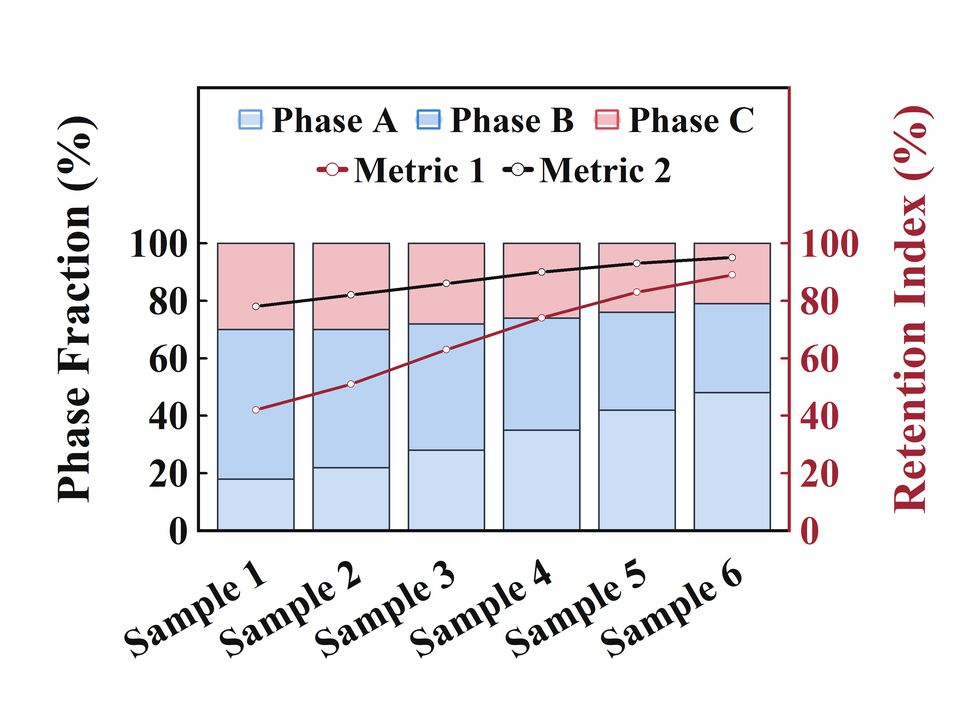
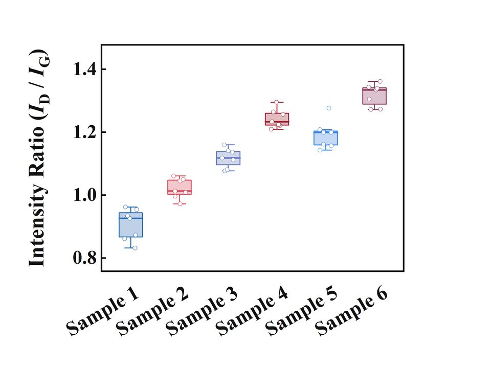

# Origin-Sci-Pipeline-Skills (SciOrigin v6.0)

<p align="center">
  <strong>跨材料科研表征、电化学动力学与 100% OriginPro 原生无头出图 Agent Skill 套件</strong><br/>
  <em>Cross-Material Characterization, Electrochemistry Kinetics &amp; Headless OriginPro Native Plotting Suite</em>
</p>

<p align="center">
  
  
  
  
</p>

---

## 核心特性 | Key Highlights

1. **100% OriginPro 原生构建与同源直出（零 Matplotlib 伪渲染）**
   - 直接通过 `originpro` + `OriginExt` COM 无头会话生成 **100% 双击可编辑的 `.opju` 工程**（完整保留原始数据表、含基线分峰列、矩阵工作簿与图层关联），并在同一会话内经 `expGraph`（`tr.Margin:=2`）直出 **`600 DPI` 24-bit LZW 无损 `.tif`**、**`300 DPI .png`**、轻量质检预览图 `_qa_previews/*_preview.jpg`，同步导出结构化 **Source-Data `.xlsx`** 与审计日志 **`quality_audit.json`**。
   - 仅当运行环境未安装 OriginPro 且显式传入 `--skip-origin` 时，才切换至纯 Python 离线预览兜底。

2. **两套一键切换出版样式预设（`Times New Roman Bold` vs `Arial Regular`）**
   - **`style_publication_minimal`（默认，别名 `"minimal"` / `"tnr"` / `"times"`）**：全局 **`Times New Roman` 100% 加粗**；图框线宽 **`3.0 pt`**（内插图/色标条 `2.0 pt`），主曲线 **`3.0 pt`**（分峰/误差棒/辅助线 `1.6 pt`）；统一四级字号：**坐标轴标题 `28 pt` / 刻度与分类标签 `24 pt` / 框内图注 `22 pt` / 图中标注与数值 `22 pt`**。
   - **`style_arial_clean`（别名 `"arial"` / `"arial_clean"`）**：全局 **`Arial` 100% 常规不加粗**；图框线宽 **`1.5 pt`**（内插图/色标条 `1.0 pt`），主曲线 **`2.0 pt`**（辅助线 `1.2 pt`）；字号层级与物理画幅坐标与默认预设完全一致。

3. **双族像素级等高画布（论文并排拼版无需二次缩放）**
   - **标准 `4:3` 矩形单图族**：页面 **`10.40 × 7.80 in`**（`3120 × 2339 px` @ 300 DPI），内框锁定 `(left=2.15, top=0.95, width=6.40, height=4.80) in`。
   - **`1:1` 等比例正方单图族**（Nyquist 阻抗、二维原位云图、相关性热力图）：页面 **`9.00 × 7.80 in`**（`2700 × 2339 px` @ 300 DPI），内框锁定 `(left=2.15, top=0.95, width=4.80, height=4.80) in`。
   - 两大家族共享完全相同的页面总高及内框上下边沿像素坐标，单页双联 Bode 图外包络同样严丝合缝对齐。

4. **四张科研工作卡审计闭环（防盲套模型、防静默捏造单位）**
   - 固定 **「核对数据 → 选择方法 → 审查结论 → 出图与交付」** 四卡流程：陌生谱区强制先出 `raw_preview` 原谱预览，重叠多解峰先跑 `model_sensitivity` 多候选模型敏感性对比并检出参数触界（`WARN_CENTER_AT_BOUND`），缺失活性物质质量时自动降级为 `mAh` 并阻断强行折算 `mAh g^-1`。

---

## 合成示例画廊 | Synthetic Showcase Gallery

> 以下示例由 [`examples/generate_synthetic_gallery.py`](./examples/generate_synthetic_gallery.py) 采用纯数学解析函数（Randles–Warburg 等效电路、合成相分数、二维高斯弛豫场与随机正态平行样）在无头 OriginPro 2024 中实时生成：

| 预设 1：`Times New Roman Bold` (`3.0 pt` 框/线) | 预设 2：`Arial Regular` (`1.5 pt` 框 / `2.0 pt` 线) |
| :---: | :---: |
| <br/><sub><b>双 Y 轴复合图 (`dual_y_combo`)</b> · `4:3` (`3120×2339 px`)</sub> | <br/><sub><b>双 Y 轴复合图 (`--style arial`)</b> · `4:3` (`3120×2339 px`)</sub> |
| <br/><sub><b>1:1 Nyquist 阻抗 + 高频放大内插图</b> · `1:1` (`2700×2339 px`)</sub> | <br/><sub><b>1:1 Nyquist 阻抗 (`--style arial`)</b> · `1:1` (`2700×2339 px`)</sub> |

| 二维连续伪彩云图 (`contour_pseudocolor_2d`) | 多平行样箱线 + 二维抖动散点 (`stat_distribution`) |
| :---: | :---: |
| <br/><sub>64 阶原生 `GLayer` 连续渐变色标条（零宋体/零胶囊粗框）</sub> | <br/><sub>柔光粉彩四分位箱 + `3.0 pt` 中位线 + 纯 2D 对称抖动圆点</sub> |

---

## 支持的 26 种科研分析与声明式图型模式 | Supported Modes

### A. 仪器表征解析与物理约束分峰管线（14 种）
| 模式 (`mode`) | 适用表征与输入格式 | 核心产物 |
| :--- | :--- | :--- |
| `raw_preview` | XPS / Raman / 陌生谱区原谱快速侦察 (`.xls/.xlsx/.txt/.csv`) | 信噪比 `SNR` 审计 + 原谱 `.opju` / `.tif` |
| `deconvolve` | XPS / Raman 物理约束 Pseudo-Voigt 分峰（Shirley / Linear 基线） | 含基线分峰 `.opju` + 双口径比例汇总 `.xlsx` |
| `model_sensitivity` | 严重重叠谱区多候选模型并排试算与参数触界审查 | `(a)-(d)` 对照联图 + 敏感度波动表 `.xlsx` |
| `batch_deconvolve` | 多样品 × 多微区平行样去尖峰、批量分峰与 `均值±SD` 聚合 | `4:3` 面板网格 `.opju` + 堆积柱图 + 统计总表 |
| `replot_deconv` | 读取已有分峰结果表一键重绘统一出版样式 | 标准样式 `.opju` + `600 DPI .tif` |
| `waterfall` | XRD (`.rasx/.asc/.txt`)、FTIR (`.csv/.spa`)、Raman 多谱叠置瀑布图 | 自动错位峰标与特征虚线 `.opju` + 原始/偏移双表 |
| `nyquist` | EIS 交流阻抗谱 (`.txt/.z60/.csv/.bin`) | 严格 `1:1` 正方主图 + 高频白底放大内插图 `.opju` |
| `bet_porosity` | $\text{N}_2$ 吸脱附等温线 + BJH/DFT 孔径分布 (`.csv/.xlsx`) | 实/空心滞后环主图 + BJH 内插图 `.opju` |
| `particle_size` | 激光粒度分布 (`.xls/.xlsx`) | `Log10` 横轴 + 微分/累积双 Y 轴 `.opju` + $D_{10}/D_{50}/D_{90}$ |
| `epr_spectrum` | 电子顺磁共振一阶微分谱 (`.asc/.dsc/.dta`) | 过零 $g$ 因子与 $\Delta g_{\text{pp}}$ 标注 `.opju` |
| `conductivity` | 粉体压实密度与电导率联动测试 (`.xlsx`) | 压强–电导率/压实密度双 Y 轴 `.opju` |
| `neware_galvanostatic` | 恒流充放电/倍率测试（支持 `.csv/.ndax/.nda` 直读） | 倍率曲线簇 `.opju` + 质量缺项安全降级核验 |
| `xy_trend` | 通用多序列点线/对数趋势对比 | 自动最空角框内图注 `.opju` |
| `composite_figure` | 多模态论文主图拼版（如 `2×2` XPS + Raman + 倍率 + `1:1` EIS） | 同行等高 `MasterComposite` 首页 + 独立子图文件夹 |

### B. 声明式图型语法引擎（12 种，`chart_grammar`）
| 模式 (`mode`) | 典型科研场景与视觉规范 |
| :--- | :--- |
| `bar_grouped_gradient` | 单指标多组或簇状分组柱状图（柔光粉彩实填充 + `1.5 pt` 同系深色边框 + SD 误差棒 + 柱顶数值） |
| `bar_stacked` / `bar_stacked_100pct` | 绝对值堆积柱 / `0–100%` 归一化堆积柱（刻度严格截断于 `100`，上方预留纯净框内图注天际线） |
| `dual_y_combo` | 左轴堆积柱/柱状图 + 右轴多指标点线双 Y 轴全高零点对齐复合图 |
| `curve_with_inset` | 主曲线簇 + `zoom` 局部放大框（切角虚线导引）或独立 `subchart` 子图内插层 |
| `electrochem_kinetics` | 子模式 `pulse_align`（短脉冲归零与瞬态压降拆解）、`galvanostatic_dqdv`（充放电 + S-G 微分容量联图）、`ragone` |
| `contour_pseudocolor_2d` | `260×260` 双线性平滑二维伪彩云图 + 右侧等高 64 阶原生 `GLayer` 渐变色标尺 + 可选 `side_panel` |
| `xy_fit_and_band` | 二维散点 + 线性/幂律/指数回归曲线 + 95% 置信阴影带 + 框内斜体方程与 $R^2$ |
| `bode_dual_panel` | EIS Bode 上下双层联图（上层 `\|Z\|` 含共享框内图注，下层 `-Phase` 共享对数频率轴） |
| `stat_distribution` | Tukey 五数概括粉彩箱线图 + 中位粗线 + T 帽须线 + 确定性对称抖动二维平行样散点 |
| `matrix_heatmap` | `1:1` 正方形相关性/参数矩阵热力图 + 纯白分隔网格 + 自适应黑白字色数值 + 45° 端点对齐底轴标签 |
| `chart_grammar` | 支持任意 `nrows × ncols` 不等宽网格与多图层自由叠加的底层声明式 JSON 入口 |

---

## 环境要求与一键安装 | Installation

### 1. 运行依赖
- **操作系统**：Windows 10 / 11（无头 COM 自动化需桌面版 **OriginPro 2024 (`10.1`) 或更高版本**）
- **Python 环境**（建议 Python `3.10–3.12`）：
  ```bash
  pip install originpro numpy scipy pandas openpyxl pillow
  ```

### 2. 安装到 AI Coding Agent（Antigravity / Cursor / Claude Code 等）
克隆仓库后执行内置安装脚本，一键同步至当前工作区 `.agents/skills/sci-origin-pipeline` 与全局插件目录：

```powershell
git clone https://github.com/Jakiewbe/Origin-Sci-pipeline-Skills.git
cd Origin-Sci-pipeline-Skills

# 仅安装到指定项目工作区（默认当前目录）
powershell -ExecutionPolicy Bypass -File .\install_skill.ps1 -Scope Workspace -ProjectRoot "D:\path\to\your_project"

# 同时安装到工作区与 Antigravity 全局插件目录 (~/.gemini/config/plugins/sci-origin-pipeline)
powershell -ExecutionPolicy Bypass -File .\install_skill.ps1 -Scope Both
```

---

## 快速上手 | Quick Start

启动脚本 [`invoke_sciorigin.ps1`](./skills/sci-origin-pipeline/scripts/invoke_sciorigin.ps1) 会自动探测本机安装有 `originpro` 的 Conda / Python 环境：

### 1. 扫描目录与侦察原始文件（工作卡一）
```powershell
# 扫描实验文件夹，自动识别仪器格式与模态分布
powershell -ExecutionPolicy Bypass -File .\skills\sci-origin-pipeline\scripts\invoke_sciorigin.ps1 scan "D:\Data\Batch_01"

# 细查单个工作簿或测试文件（工作表、结合能/频率范围、估计信噪比 SNR）
powershell -ExecutionPolicy Bypass -File .\skills\sci-origin-pipeline\scripts\invoke_sciorigin.ps1 inspect "D:\Data\Batch_01\Sample1_XPS.xls"
```

### 2. 生成配置模板并一键出图（支持切换默认新罗马加粗 / Arial 常规预设）
```powershell
# 导出任意模式的标准 JSON 配置模板（例如 dual_y_combo / nyquist / deconvolve / contour_pseudocolor_2d）
powershell -ExecutionPolicy Bypass -File .\skills\sci-origin-pipeline\scripts\invoke_sciorigin.ps1 init-template dual_y_combo > task_config.json

# 使用默认预设（Times New Roman Bold，框线 3pt / 主线 3pt）原生构建 .opju + 600 DPI .tif + 300 DPI .png
powershell -ExecutionPolicy Bypass -File .\skills\sci-origin-pipeline\scripts\invoke_sciorigin.ps1 run .\task_config.json

# 一键切换为 Arial 常规预设（Arial Regular 不加粗，框线 1.5pt / 主线 2pt）
powershell -ExecutionPolicy Bypass -File .\skills\sci-origin-pipeline\scripts\invoke_sciorigin.ps1 run .\task_config.json --style arial
```

也可直接在 `task_config.json` 顶层写入 `"style_preset": "style_publication_minimal"`（或 `"arial"`）持久化锁定样式。

### 3. 本机复现合成示例画廊
无需任何外部实验数据，直接运行合成示例脚本即可在本地验证 OriginPro 无头渲染全链路：

```powershell
python .\examples\generate_synthetic_gallery.py
```

---

## 仓库目录结构 | Repository Layout

```text
Origin-Sci-pipeline-Skills/
├── plugin.json                                     # Agent 插件清单 (v6.0.0)
├── install_skill.ps1                               # 工作区 / 全局插件一键同步脚本
├── assets/
│   ├── logo.svg                                    # 插件矢量图标
│   └── gallery/                                    # 纯数学合成示例展示图
├── examples/
│   └── generate_synthetic_gallery.py               # 零外部依赖的 OriginPro 原生合成示例生成器
└── skills/sci-origin-pipeline/
    ├── SKILL.md                                    # 总控路由与四张科研工作卡入口
    ├── presets/
    │   ├── style_publication_minimal.json          # 预设 1（默认）：Times New Roman 加粗 (3.0/3.0 pt, 28/24/22/22 pt)
    │   ├── style_arial_clean.json                  # 预设 2：Arial 常规不加粗 (1.5/2.0 pt, 28/24/22/22 pt)
    │   ├── chart_catalog.json                      # 声明式图型语法字段字典与配方目录
    │   ├── modality_catalog.json                   # 多材料表征与电化学模态解析目录
    │   ├── raman_carbon_presets.json               # 碳材料一阶 Raman D*/D/D''/G 分峰预设（按需显式启用）
    │   └── xps_cfx_battery_presets.json            # 氟化碳电极 XPS 分峰与多候选模型参考预设（按需显式启用）
    ├── references/
    │   ├── card_01_inspect_data.md                 # 工作卡一：核对数据
    │   ├── card_02_choose_method.md                # 工作卡二：选择方法
    │   ├── card_03_audit_conclusions.md            # 工作卡三：审查结论
    │   ├── card_04_plot_and_deliver.md             # 工作卡四：出图与交付
    │   ├── origin_opju_architecture.md             # OriginPro 无头架构与 OriginExt 三大防崩溃守卫
    │   ├── publication_visual_and_origin_craft.md  # 零上划线覆盖层、1052B RIFF 色板与 COM 实战手册
    │   ├── xps_raman_deconvolution_guide.md        # XPS / Raman 物理约束分峰参考
    │   ├── electrochem_and_characterization_guide.md
    │   └── case_cfx_xps_and_f1s_models.md          # 重叠谱峰四组候选模型敏感性决策案例
    └── scripts/
        ├── invoke_sciorigin.ps1                    # Python + originpro 环境自动探测启动器
        ├── run_pipeline.py                         # CLI 总控入口
        ├── origin_theme.py                         # 双预设运行时引擎、粉彩配色与 RIFF .pal 二进制生成
        ├── chart_grammar.py                        # 声明式图型语法编译器 (FigureSpec / PanelSpec / LayerSpec)
        ├── origin_renderer.py                      # 声明式多图型 OriginPro 原生渲染引擎
        ├── origin_builder.py                       # 表征分峰 .opju 构建器、零上划线排版覆盖层与 expGraph 导出器
        ├── electrochem_transforms.py               # 宽表/平行样聚合、dQ/dV 求导、脉冲归零分解与 2D 矩阵变换
        ├── parsers.py / fitting.py / excel_exporter.py / validator.py
        └── plotter.py / pubstyle.py                # 仅用于 --skip-origin 的离线预览兜底
```

---

## License

Released under the [MIT License](./LICENSE).
