<p align="center">
  
</p>

<h1 align="center">Origin-Sci-Pipeline-Skills · SciOrigin v6.0</h1>

<p align="center">
  <strong>跨材料科研表征、电化学动力学与 100% OriginPro 原生无头出图 Agent Skill 套件</strong><br/>
  <em>Cross-Material Characterization, Electrochemistry Kinetics &amp; Headless OriginPro 2024 Native Plotting Suite</em>
</p>

<p align="center">
  
  
  
  
  
  
</p>

<p align="center">
  <a href="#architecture"><strong>架构工作流</strong></a> ·
  <a href="#flagship"><strong>2×2 多模态主图</strong></a> ·
  <a href="#highlights"><strong>核心特性</strong></a> ·
  <a href="#gallery"><strong>27 图原生画廊</strong></a> ·
  <a href="#modes"><strong>26 种模式速查表</strong></a> ·
  <a href="#quickstart"><strong>安装与复现 CLI</strong></a> ·
  <a href="#layout"><strong>目录结构</strong></a>
</p>

---

<a id="architecture"></a>

## 端到端科研审计与原生渲染架构 | End-to-End Architecture

<p align="center">
  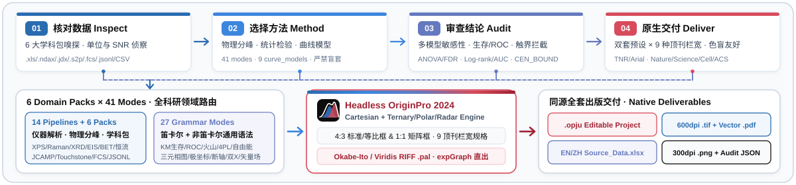
</p>

<p align="center">
  <sub>固定 <strong>「01 核对数据 → 02 选择方法 → 03 审查结论 → 04 原生交付」</strong> 四张工作卡闭环，驱动 14 条仪器表征分峰管线与 12 种声明式图型语法，由无头 OriginPro 2024 COM 会话同源产出可双击编辑 <code>.opju</code>、<code>600 DPI LZW .tif</code>、结构化 <code>Source-Data .xlsx</code> 与 <code>quality_audit.json</code>。</sub>
</p>

---

<a id="flagship"></a>

## 旗舰多模态论文主图拼版 | Flagship Multi-Modal Showcase

| <br/>**2×2 跨模态论文主图同页联动拼版** · `composite_figure` / `chart_grammar`<br/><sub>单页 MasterComposite (`1800×1298 px`)：`(a)` Pseudo-Voigt 多峰拟合与包络线 + `(b)` 四态衍射叠谱演化 + `(c)` `0.1 C–10 C` 顺序蓝红多倍率放电簇 + `(d)` 严格 `1:1` 等比例 Nyquist 交流阻抗谱</sub> |
| :---: |

---

<a id="highlights"></a>

## 四大核心支柱 | Core Highlights

| 支柱 | 工程与科研审计机制 |
| :--- | :--- |
| **1. 100% OriginPro 原生同源直出**<br/><sub>Zero-Matplotlib Native COM</sub> | 直接通过 `originpro` + `OriginExt` 无头会话构建 **100% 双击可编辑 `.opju` 工程**（完整保留原始工作表、含基线分峰列、二维矩阵簿与 `GLayer` 图层绑定），同会话经 `expGraph`（`tr.Margin:=2`）直出 **`600 DPI` 24-bit LZW 无损 `.tif`**、**`300 DPI .png`**、质检预览图及同源 **Source-Data `.xlsx`**。 |
| **2. 双套出版预设一键像素级切换**<br/><sub>Dual Publication Themes</sub> | 默认 [`style_publication_minimal`](./skills/sci-origin-pipeline/presets/style_publication_minimal.json)（`Times New Roman Bold`，`3.0 pt` 闭合粗框 / `3.0 pt` 主线）与轻量 [`style_arial_clean`](./skills/sci-origin-pipeline/presets/style_arial_clean.json)（`Arial Regular` 不加粗，`1.5 pt` 细框 / `2.0 pt` 主线）共享 `28 / 24 / 22 / 22 pt` 四级字号与物理坐标，传 `--style arial` 即可无损切换。 |
| **3. 同尺寸画布与 `4:3` / `1:1` 零变形对齐**<br/><sub>Pixel-Locked Canvas Geometry</sub> | 全部单面板图表统一锁定 **`10.40 × 7.80 in`**（标准 `4:3` 外轮廓）：常规趋势图采用 `6.40 × 4.80 in` 矩形内框，Nyquist 阻抗、二维原位云图与相关性热力图居中锁定 **`4.80 × 4.80 in` 严格 `1:1` 正方内框**，上下黑框边沿（`0.95..5.75 in`）零像素偏差，双栏并排拼版无需二次缩放。 |
| **4. 四卡科研审计与防误判硬门禁**<br/><sub>4-Card Scientific Audit</sub> | 陌生谱区强制先跑 `raw_preview` 评估信噪比 `SNR`；重叠多解谱峰先经 `model_sensitivity` 并排比对候选模型并自动拦截参数触界（`CEN_BOUND` / `WARN_CENTER_AT_BOUND`）；缺失活性物质质量时自动安全降级为 `mAh` 并阻断强行折算 `mAh g⁻¹`。 |

---

<a id="gallery"></a>

## 全景 OriginPro 原生合成画廊（27 图） | Full-Spectrum Native Gallery

> 全部 **27 张示例图**均由 [`examples/generate_synthetic_gallery.py`](./examples/generate_synthetic_gallery.py)（串联 Part 1–3 模块）基于纯数学解析方程在 **Headless OriginPro 2024** 中实时渲染生成，零外部文件依赖、零私有实验数据。同行图表严格锁定一致长宽比，确保等宽排布零高度错位。

### Showcase I · 双套出版预设一键切换对照（`Times New Roman Bold` vs `Arial Regular`，4 图）

| 默认预设：`style_publication_minimal` (`Times New Roman Bold`) | 轻量预设：`style_arial_clean` (`--style arial`) |
| :---: | :---: |
| <br/>**双 Y 轴相组成与保持率复合图** · `dual_y_combo`<br/><sub>`3.0 pt` 闭合粗框 · 左轴 100% 堆积柱 + 右轴语义染色点线 · 全高零点对齐</sub> | 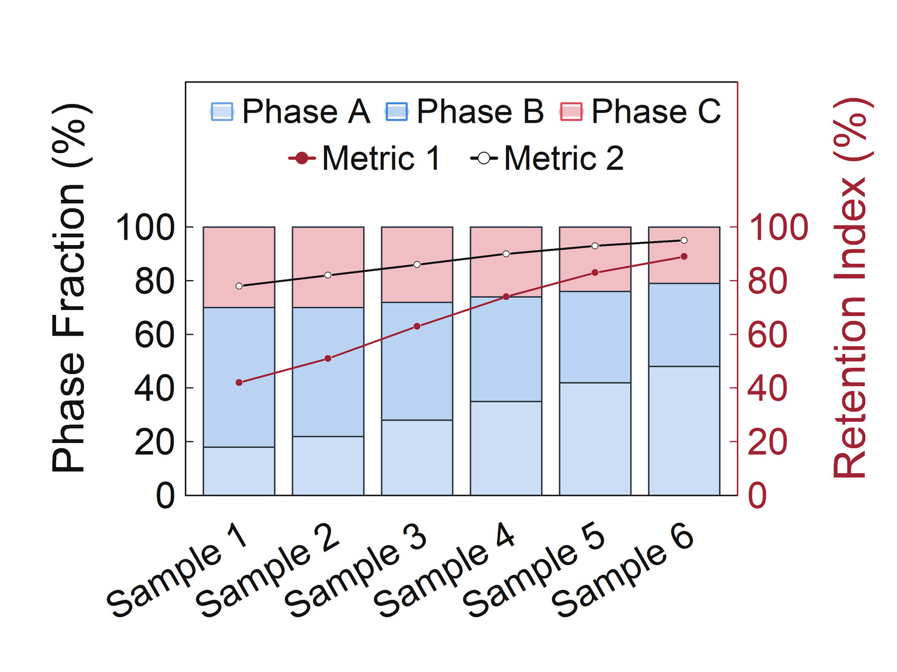<br/>**双 Y 轴复合图（Arial 常规预设）** · `dual_y_combo`<br/><sub>`1.5 pt` 闭合细框 · `2.0 pt` 主线 · 全图常规无衬线字体像素级同坐标切换</sub> |
| 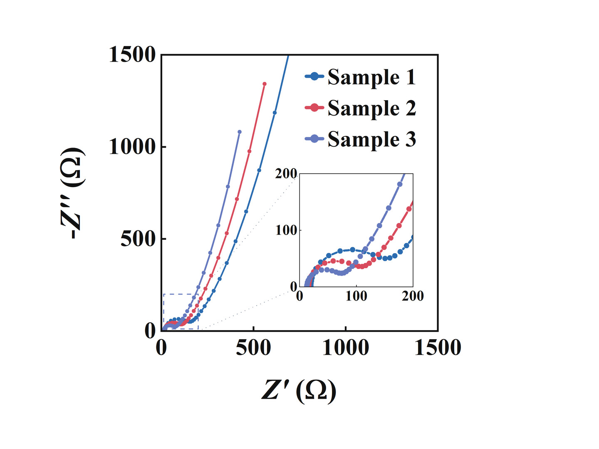<br/>**1:1 等比例 Nyquist 阻抗谱（新罗马加粗）** · `curve_with_inset`<br/><sub>`4.80×4.80 in` 严格正方内框 · 纯白底高频放大 `zoom` 内插层 · 虚线选框导引</sub> | <br/>**1:1 等比例 Nyquist 阻抗谱（Arial 常规）** · `curve_with_inset`<br/><sub>`1.0 pt` 内插细框 · `1:1` 实虚部等比例刻度锁定 · `10.40×7.80 in` 同画布</sub> |

---

### Showcase II · 仪器表征解析与物理约束分峰画廊（`Characterization & Deconvolution`，9 图）

| 表征与分峰示例 A（`4:3` 标准同画布 `1440×1080`） | 表征与分峰示例 B（`4:3` 标准同画布 `1440×1080`） |
| :---: | :---: |
| <br/>**XPS C 1s 四峰物理约束分峰** · `deconvolve`<br/><sub>反演结合能横轴 (`296→282 eV`) · Shirley 非线性基线 · 半透明 Pseudo-Voigt 子峰</sub> | <br/>**无序碳一阶 Raman 四峰拟合** · `deconvolve`<br/><sub>`D* / D / D'' / G` 物理约束分解 · 包络拟合实线 · 框内自动标注 `I_D / I_G` 比值</sub> |
| 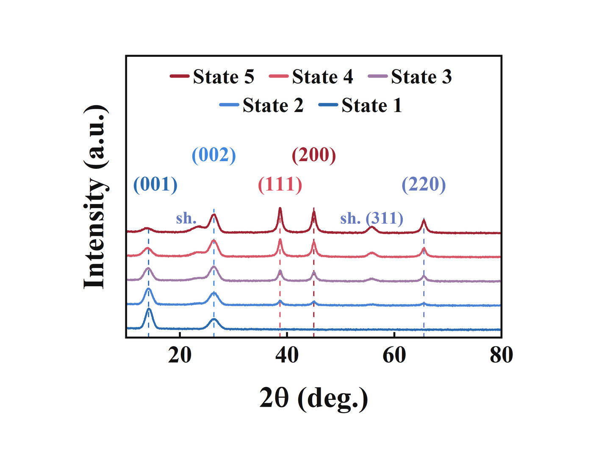<br/>**五态物相演化 XRD 叠置瀑布图** · `waterfall`<br/><sub>蓝红顺序语义色阶 · 贯穿式衍射晶面竖向虚线导引 · 自动避让峰肩标注</sub> | 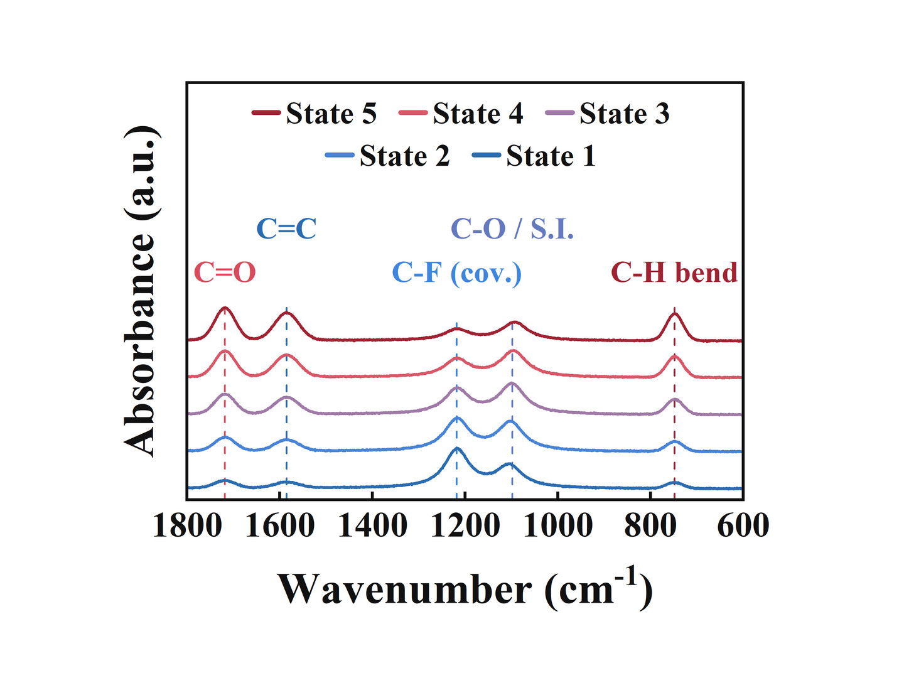<br/>**反演波数五态 FTIR 红外叠谱** · `waterfall`<br/><sub>`1800→600 cm⁻¹` 反演横轴 · 任意强度轴自动隐去冗余刻度 · 特征官能团虚线</sub> |
| 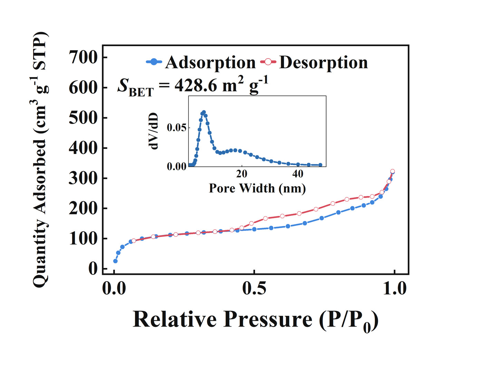<br/>**IV 型 N₂ 吸脱附等温线与孔径分布** · `bet_porosity`<br/><sub>实心吸附 / 白芯空心脱附滞后环 · 框内嵌套独立坐标 BJH `dV/dD` 孔径内插图</sub> | 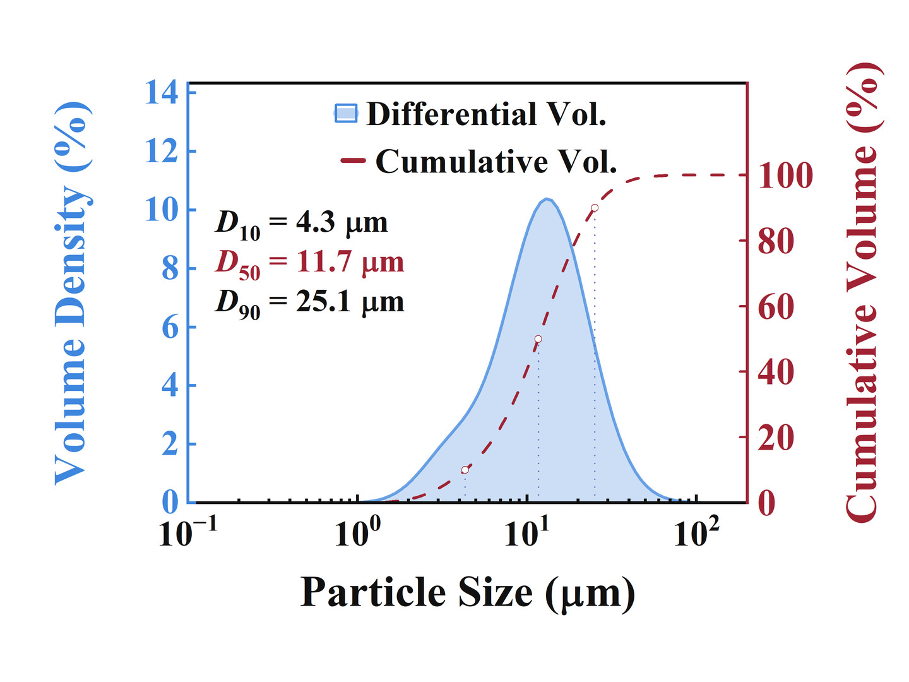<br/>**激光粒度对数微分与累积分布** · `particle_size`<br/><sub>`Log10` 粒径横轴开启次刻度 · 微分体积分数与 `0–100%` 累积双 Y 轴 · `D10/D50/D90`</sub> |
| 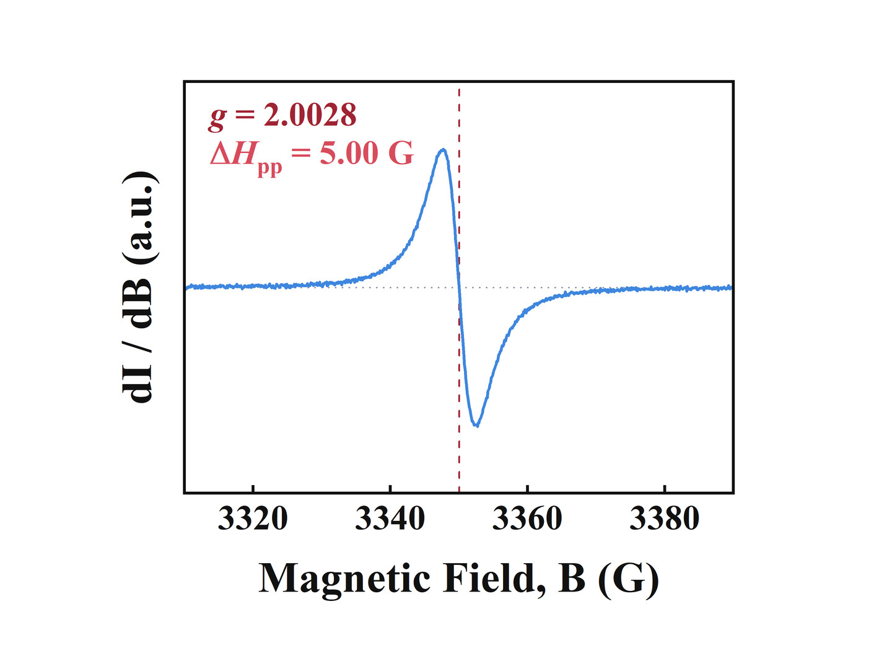<br/>**顺磁共振一阶微分洛伦兹谱** · `epr_spectrum`<br/><sub>一阶导数 `dI/dB` 对称线型 · 过零中心场 `g = 2.0028` 竖向导引 · `ΔH_pp` 线宽标注</sub> | <br/>**粉体压实压强–电导率与压实密度联动** · `conductivity`<br/><sub>`5–60 MPa` 连续加载 · 左轴电导率与右轴压实密度双 Y 轴联动与语义色绑定</sub> |

| 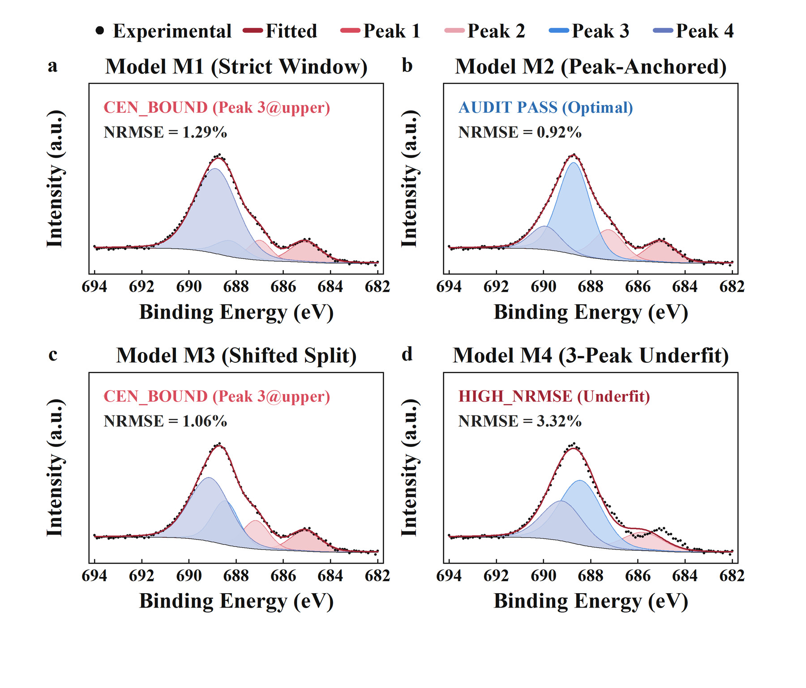<br/>**重叠多解谱区四候选模型敏感性与触界审查联图** · `model_sensitivity`<br/><sub>`2×2` `(a)–(d)` 多模型并排试算 (`1800×1538 px`) · 自动检出峰位触碰边界约束 (`CEN_BOUND`) 并量化组分面积比例波动区间</sub> |
| :---: |

---

### Showcase III · 电化学动力学、阻抗谱与原位二维场画廊（`Electrochemistry & Operando 2D`，7 图）

| 多倍率恒流放电 (`1440×1080`) | 高倍率短脉冲瞬态拆解 (`1440×1080`) | 双对数 Ragone 图 (`1440×1080`) |
| :---: | :---: | :---: |
| 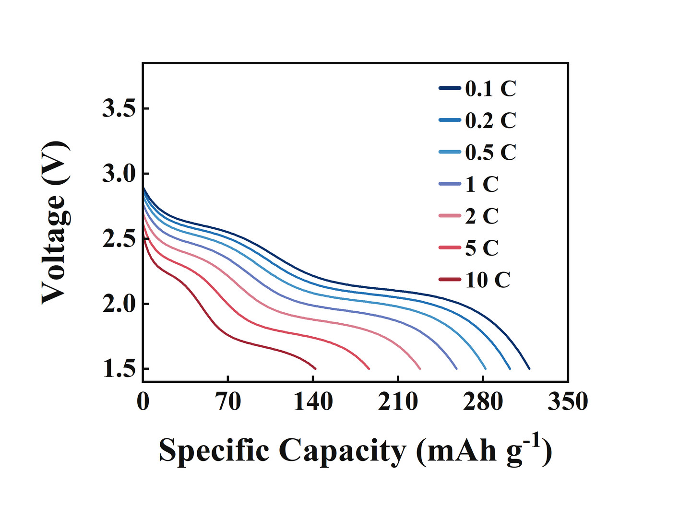<br/>**七倍率恒流放电曲线簇** · `neware_galvanostatic`<br/><sub>`0.1 C–10 C` 深蓝至暗红顺序色阶 · 平台拐点与框内紧凑图注</sub> | 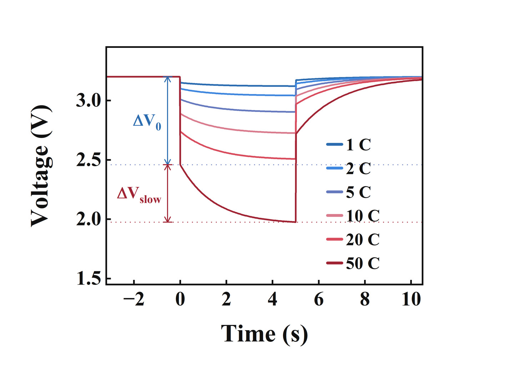<br/>**短脉冲时间归零与极化拆解** · `electrochem_kinetics`<br/><sub>脉冲起点 `t = 0` 对齐 · 欧姆压降 `ΔV₀` 与慢极化 `ΔV_slow` 跨度导引</sub> | <br/>**双对数能量–功率密度图** · `electrochem_kinetics`<br/><sub>`Log10–Log10` 主次内向刻度 · 四种电极架构功率保持率对比</sub> |

| EIS Bode 双层共享频率阻抗谱 (`1440×1080`) | 二维弛豫时间分布伪彩云图 (`1440×1080`) |
| :---: | :---: |
| <br/>**Bode 模值与相角上下双层联图** · `bode_dual_panel`<br/><sub>单页双 `GLayer` 外包络 `0.95..5.75 in` 对齐 · 共享 `Log10(Freq)` 横轴与顶层图注</sub> | 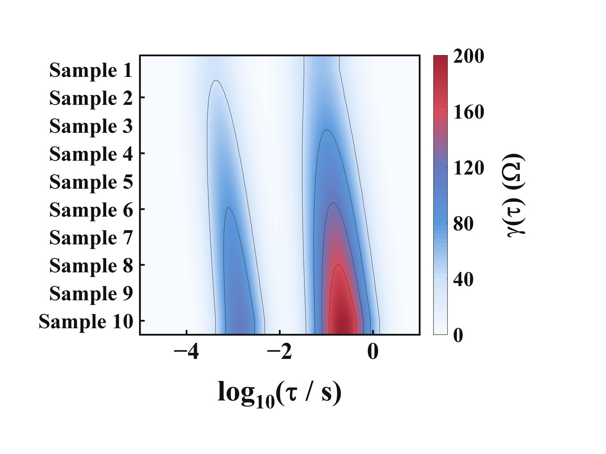<br/>**二维连续 DRT 弛豫时间分布云图** · `contour_pseudocolor_2d`<br/><sub>`1:1` 正方矩阵场 · `1052B RIFF .pal` 零本底纯白蓝红色板 · 64 阶原生 `GLayer` 色标尺</sub> |

| 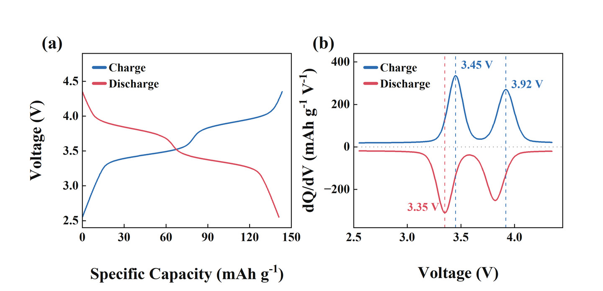<br/>**恒流充放电曲线与 Savitzky-Golay 微分容量双面板联图** · `electrochem_kinetics` (`galvanostatic_dqdv`)<br/><sub>`1×2` 横向耦合画幅 (`1440×695 px`) · 左图充放电电压平台与右图平滑 `dQ/dV` 氧化还原特征峰竖向虚线一一对应</sub> |
| :---: |

| <br/>**原位二维连续伪彩演化场与同步电化学状态曲线耦合图** · `contour_pseudocolor_2d` (`side_panel`)<br/><sub>双面板不等宽联动 (`1800×1089 px`) · 左侧零本底纯白蓝红原位二维强度场与右侧纵向状态–电压曲线严格共享状态纵轴</sub> |
| :---: |

---

### Showcase IV · 声明式统计分布、回归置信带与矩阵语法画廊（`Declarative Statistical & Matrix Grammar`，6 图）

| 声明式统计与分类语法 A（`4:3` `1440×1080`） | 声明式回归与矩阵语法 B（`4:3` `1440×1080`） |
| :---: | :---: |
| <br/>**分组柔光柱状图与标准差误差棒** · `bar_grouped_gradient`<br/><sub>`1052B` 离散色板实填充 · `1.5 pt` 同系深色描边 · `SD` 误差棒与柱顶同色加粗数值</sub> | 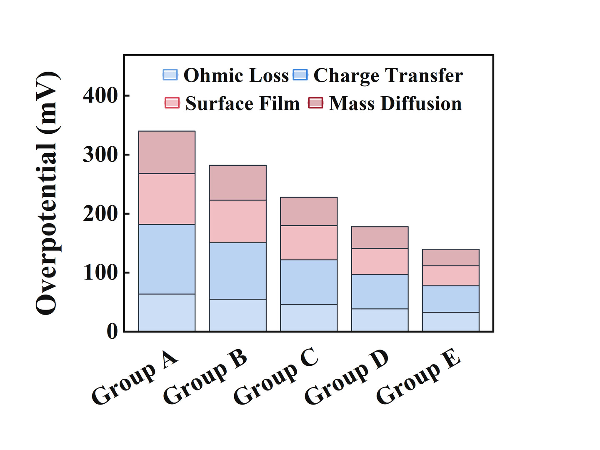<br/>**四组分极化过电位绝对值堆积柱** · `bar_stacked`<br/><sub>底层惰性至顶层活性三明治语义色阶 · `0.8 pt` 纯白层间分隔线 · 框内顶置横排图注</sub> |
| 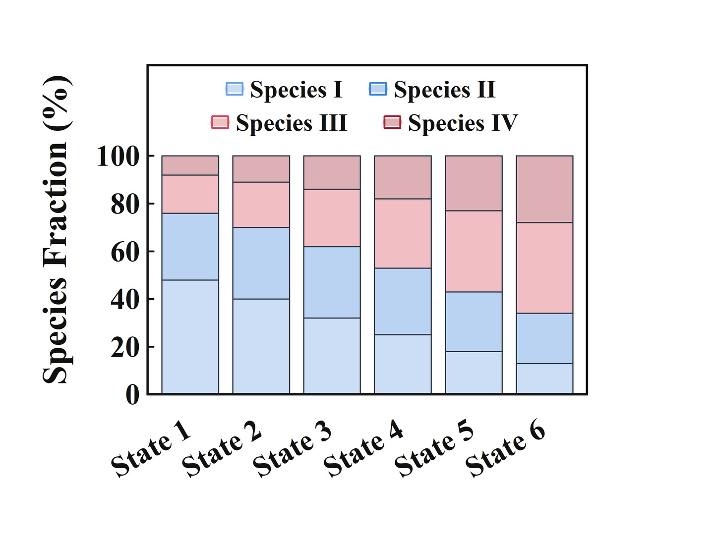<br/>**0–100% 归一化化学物种演化堆积柱** · `bar_stacked_100pct`<br/><sub>Y 轴上限留出纯净图注天际线且刻度严格截断于 `0..100`（零 `120%` 伪刻度残留）</sub> | <br/>**二维散点线性回归与 95% 置信阴影带** · `xy_fit_and_band`<br/><sub>纯 2D 圆点散点 · 半透明 95% 置信区间填充带 · 自动斜体排版回归方程与 `R²`</sub> |
| <br/>**多平行样 Tukey 箱线与对称抖动散点** · `stat_distribution`<br/><sub>柔光粉彩四分位箱体 · `3.0 pt` 中位粗横杠与 T 帽须线 · 确定性对称抖动实测圆点</sub> | <br/>**1:1 构效关系 6×6 相关性矩阵热力图** · `matrix_heatmap`<br/><sub>蓝–白–红中心归零发散色板 · `0.8 pt` 纯白单元格网格 · 自适应黑白字色数值与 `45°` 底轴标签</sub> |

---

<a id="modes"></a>

## 26 种科研分析与声明式图型模式全景速查表 | Supported Modes

### A. 仪器表征解析与物理约束分峰管线（14 种，`Characterization Pipelines`）

| # | 模式 (`mode`) | 适用表征与输入格式 | 核心交付产物 | 示例图 (`Preview`) |
| :---: | :--- | :--- | :--- | :--- |
| 01 | `raw_preview` | XPS / Raman / 陌生谱区原谱快速侦察 (`.xls/.xlsx/.txt/.csv`) | 信噪比 `SNR` 审计 + 原谱 `.opju` / `.tif` | [XPS 谱区示例](./assets/gallery/demo_xps_deconv.jpg) |
| 02 | `deconvolve` | XPS / Raman 物理约束 Pseudo-Voigt 分峰（Shirley / Linear 基线） | 含基线分峰 `.opju` + 双口径比例汇总 `.xlsx` | [XPS C 1s](./assets/gallery/demo_xps_deconv.jpg) · [Raman](./assets/gallery/demo_raman_deconv.jpg) |
| 03 | `model_sensitivity` | 严重重叠谱区多候选模型并排试算与参数触界 (`CEN_BOUND`) 审查 | `(a)–(d)` 对照联图 + 敏感度波动表 `.xlsx` | [2×2 四模型联图](./assets/gallery/demo_model_sensitivity.jpg) |
| 04 | `batch_deconvolve` | 多样品 × 多微区平行样去尖峰、批量分峰与 `均值±SD` 聚合 | 多面板分峰网格 `.opju` + 统计汇总总表 `.xlsx` | [多模型网格](./assets/gallery/demo_model_sensitivity.jpg) · [平行样分布](./assets/gallery/demo_box_jitter.jpg) |
| 05 | `replot_deconv` | 读取已有分峰结果表一键重绘统一出版样式（不擅自重拟合） | 标准双预设 `.opju` + `600 DPI LZW .tif` | [Raman 四峰重绘](./assets/gallery/demo_raman_deconv.jpg) |
| 06 | `waterfall` | XRD (`.rasx/.asc/.txt`)、FTIR (`.csv/.spa`)、Raman 多谱叠置瀑布图 | 自动错位峰标与特征虚线 `.opju` + 原始/偏移双表 | [XRD 叠谱](./assets/gallery/demo_xrd_waterfall.jpg) · [FTIR 叠谱](./assets/gallery/demo_ftir_waterfall.jpg) |
| 07 | `nyquist` | EIS 交流阻抗谱 (`.txt/.z60/.csv/.cor`) | 严格 `1:1` 正方主图 + 高频白底放大内插图 `.opju` | [TNR 预设](./assets/gallery/demo_nyquist_tnr.jpg) · [Arial 预设](./assets/gallery/demo_nyquist_arial.jpg) |
| 08 | `bet_porosity` | $\text{N}_2$ 吸脱附等温线 + BJH/DFT 孔径分布 (`.csv/.xlsx`) | 实/空心滞后环主图 + BJH 嵌套内插图 `.opju` | [N₂ 等温线+BJH](./assets/gallery/demo_bet_porosity.jpg) |
| 09 | `particle_size` | 激光粒度体积微分与累积分布 (`.xls/.xlsx`) | `Log10` 横轴 + 微分/累积双 Y 轴 `.opju` + $D_{10}/D_{50}/D_{90}$ | [对数双Y粒度](./assets/gallery/demo_particle_size.jpg) |
| 10 | `epr_spectrum` | 电子顺磁共振一阶微分谱 (`.asc/.dsc/.dta`) | 过零中心 $g$ 因子与 $\Delta H_{\text{pp}}$ 线宽标注 `.opju` | [一阶微分 EPR](./assets/gallery/demo_epr_derivative.jpg) |
| 11 | `conductivity` | 粉体压实密度与电导率联动测试 (`.xlsx/.xls`) | 压强–电导率/压实密度双 Y 轴 `.opju` + 电阻率汇总 | [压实电导率双Y](./assets/gallery/demo_conductivity_pressure.jpg) |
| 12 | `neware_galvanostatic` | 恒流充放电与多倍率测试（支持 `.csv/.ndax/.nda` 直读） | 倍率曲线簇 `.opju` + 质量缺项安全降级核验 | [7 倍率放电簇](./assets/gallery/demo_rate_galvanostatic.jpg) |
| 13 | `xy_trend` | 通用多序列定量点线、顺序演化或对数趋势对比 | 自动最空角框内无框图注 `.opju` + `.xlsx` | [倍率趋势](./assets/gallery/demo_rate_galvanostatic.jpg) · [Ragone](./assets/gallery/demo_ragone_loglog.jpg) |
| 14 | `composite_figure` | 多模态论文主图拼版（如 `2×2` 光谱 + 衍射 + 倍率 + `1:1` EIS） | 同行等高 `MasterComposite` 首页 + 独立子图文件夹 | [2×2 多模态主图](./assets/gallery/demo_hero_composite_2x2.jpg) |

### B. 声明式图型语法引擎（12 种，`Declarative Chart Grammar`）

| # | 模式 (`mode`) | 典型科研场景与 OriginPro 原生视觉工艺 | 示例图 (`Preview`) |
| :---: | :--- | :--- | :--- |
| 01 | `bar_grouped_gradient` | 单指标多样品或簇状分组柱状图（柔光粉彩实填充 + `1.5 pt` 同系深色边框 + `SD` 误差棒 + 柱顶同色数值） | [分组误差柱状图](./assets/gallery/demo_bar_grouped_gradient.jpg) |
| 02 | `bar_stacked` | 绝对值多组分堆积柱状图（三明治扁平语义色阶 + `0.8 pt` `#FFFFFF` 层间白线，禁用逐段花哨渐变） | [极化绝对值堆积](./assets/gallery/demo_bar_stacked_abs.jpg) |
| 03 | `bar_stacked_100pct` | `0–100%` 归一化百分比堆积柱（顶部自动留出框内图注净空且 Y 轴主刻度严格截断于 `0..100`） | [100% 物种演化柱](./assets/gallery/demo_bar_stacked_100pct.jpg) |
| 04 | `dual_y_combo` | 左轴堆积柱/柱状图 + 右轴多指标点线双 Y 轴复合图（全高零基线对齐 + 右轴与标题语义染色绑定） | [TNR 双Y](./assets/gallery/demo_dual_y_tnr.jpg) · [Arial 双Y](./assets/gallery/demo_dual_y_arial.jpg) |
| 05 | `curve_with_inset` | 主曲线簇 + `zoom` 局部放大选框或独立 `subchart` 内插层（支持 `equal_aspect` `1:1` 正方锁定与白底遮罩） | [Nyquist 放大](./assets/gallery/demo_nyquist_tnr.jpg) · [BET 内插](./assets/gallery/demo_bet_porosity.jpg) |
| 06 | `electrochem_kinetics` | 统一电化学动力学语法：`pulse_align`（短脉冲归零压降拆解）、`galvanostatic_dqdv`（充放电 + `dQ/dV` 联图）、`ragone` | [短脉冲](./assets/gallery/demo_pulse_align.jpg) · [dQ/dV](./assets/gallery/demo_dqdv_coupled.jpg) · [Ragone](./assets/gallery/demo_ragone_loglog.jpg) |
| 07 | `contour_pseudocolor_2d` | 二维连续伪彩云图（零本底纯白蓝红 `RIFF .pal` 色板 + 右侧等高 64 阶 `GLayer` 色标尺 + 可选 `side_panel` 联动） | [2D DRT](./assets/gallery/demo_drt_contour.jpg) · [原位联动](./assets/gallery/demo_operando_contour_side.jpg) |
| 08 | `xy_fit_and_band` | 二维散点 + 线性/幂律/多项式回归曲线 + 半透明 95% 置信阴影带 + 框内自动斜体回归方程与 $R^2$ | [回归+95%置信带](./assets/gallery/demo_xy_fit_band.jpg) |
| 09 | `bode_dual_panel` | EIS Bode 单页上下双层联图（上层 `\|Z\|` 双对数带共享图注，下层 `-Phase` 半对数共享频率横轴） | [Bode 双层阻抗](./assets/gallery/demo_bode_dual_panel.jpg) |
| 10 | `stat_distribution` | Tukey 五数概括粉彩箱线图 + `3.0 pt` 中位粗横杠 + T 帽须线 + 确定性对称抖动平行样实测散点 | [Tukey 箱线抖动](./assets/gallery/demo_box_jitter.jpg) |
| 11 | `matrix_heatmap` | `1:1` 正方形相关性/参数矩阵热力图 + `0.8 pt` 纯白网格 + 自适应黑白对比字色数值 + `45°` 底轴标签 | [6×6 相关性热图](./assets/gallery/demo_matrix_heatmap.jpg) |
| 12 | `chart_grammar` | 支持任意 `nrows × ncols` 不等宽网格（`width_ratios` / `height_ratios`）与多图层自由叠加的底层声明式入口 | [2×2 声明式拼版](./assets/gallery/demo_hero_composite_2x2.jpg) |

---

<a id="quickstart"></a>

## 环境要求、一键安装与复现 CLI | Installation & Quick Start

### 1. 运行依赖
- **操作系统**：Windows 10 / 11（无头 COM 自动化需桌面版 **OriginPro 2024 (`10.1`) 或更高版本**；离线无 Origin 环境可显式传 `--skip-origin` 启用预览兜底）
- **Python 环境**（建议 Python `3.10–3.12`）：
  ```bash
  pip install originpro numpy scipy pandas openpyxl pillow
  ```

### 2. 安装到 AI Coding Agent（Antigravity / Cursor / Claude Code 等）
执行内置同步脚本 [`install_skill.ps1`](./install_skill.ps1)，一键部署至项目工作区 `.agents/skills/sci-origin-pipeline` 或全局插件目录：

```powershell
git clone https://github.com/Jakiewbe/Origin-Sci-pipeline-Skills.git
cd Origin-Sci-pipeline-Skills

# 仅安装到指定项目工作区（默认当前目录）
powershell -ExecutionPolicy Bypass -File .\install_skill.ps1 -Scope Workspace -ProjectRoot "D:\path\to\your_project"

# 同时同步到工作区与 Antigravity 全局插件目录 (~/.gemini/config/plugins/sci-origin-pipeline)
powershell -ExecutionPolicy Bypass -File .\install_skill.ps1 -Scope Both
```

### 3. 四卡标准工作流 CLI（支持一键切换双套出版预设）
启动器 [`invoke_sciorigin.ps1`](./skills/sci-origin-pipeline/scripts/invoke_sciorigin.ps1) 会自动探测本机安装有 `originpro` 的 Conda / Python 解释器：

```powershell
# [卡一 · 核对数据] 扫描实验目录模态分布，或细查单个原始文件的谱区范围与估计信噪比 SNR
powershell -ExecutionPolicy Bypass -File .\skills\sci-origin-pipeline\scripts\invoke_sciorigin.ps1 scan "D:\Data\Batch_01"
powershell -ExecutionPolicy Bypass -File .\skills\sci-origin-pipeline\scripts\invoke_sciorigin.ps1 inspect "D:\Data\Batch_01\Sample_01_XPS.xls"

# [卡二 · 选择方法] 导出任意模式的标准化 JSON 任务配置模板
powershell -ExecutionPolicy Bypass -File .\skills\sci-origin-pipeline\scripts\invoke_sciorigin.ps1 init-template dual_y_combo > task_config.json

# [卡四 · 原生交付] 默认预设 (Times New Roman Bold, 3.0pt 框/线) 原生生成 .opju + 600 DPI .tif + Source-Data .xlsx
powershell -ExecutionPolicy Bypass -File .\skills\sci-origin-pipeline\scripts\invoke_sciorigin.ps1 run .\task_config.json

# 一键切换为 Arial 常规预设 (Arial Regular, 1.5pt 框 / 2.0pt 线)，或在 task_config.json 写入 "style_preset": "arial"
powershell -ExecutionPolicy Bypass -File .\skills\sci-origin-pipeline\scripts\invoke_sciorigin.ps1 run .\task_config.json --style arial
```

### 4. 本机一键复现全部 27 张合成画廊（Reproducible Gallery CLI）
无需任何外部实验数据，直接运行 [`examples/generate_synthetic_gallery.py`](./examples/generate_synthetic_gallery.py) 即可在本地无头 OriginPro 2024 中分模块或全量复现本仓库全部 27 张展示图：

```powershell
# 查看命令行参数说明
python .\examples\generate_synthetic_gallery.py --help

# 一键全量渲染全部 27 张合成展示图（默认 --part all）
python .\examples\generate_synthetic_gallery.py --part all

# 按模块独立渲染指定分卷（便于单模块快速验证）
python .\examples\generate_synthetic_gallery.py --part 1   # Part 1: 9 张表征与物理约束分峰图
python .\examples\generate_synthetic_gallery.py --part 2   # Part 2: 7 张 2×2 主图、电化学动力学与原位 2D 图
python .\examples\generate_synthetic_gallery.py --part 3   # Part 3: 11 张双预设对照、统计分布、回归与热力图
```

---

<a id="layout"></a>

## 仓库目录结构 | Repository Layout

```text
Origin-Sci-pipeline-Skills/
├── plugin.json                                     # Agent 插件清单 (v6.0.0)
├── install_skill.ps1                               # 工作区 / 全局插件一键同步脚本
├── assets/
│   ├── logo.svg                                    # 套件矢量徽标
│   ├── workflow_banner.svg                         # 四卡审计与无头 OriginPro 2024 原生架构矢量横幅
│   └── gallery/                                    # 27 张无头 OriginPro 2024 实时渲染纯数学合成展示图
├── examples/
│   ├── generate_synthetic_gallery.py               # 合成画廊统一 CLI 入口 (--part 1|2|3|all)
│   ├── gallery_part1_characterization.py           # Part 1：9 张仪器表征解析与多模型分峰敏感性生成器
│   ├── gallery_part2_electrochem.py                # Part 2：7 张 2×2 多模态主图、电化学动力学与原位 2D 生成器
│   └── gallery_part3_declarative.py                # Part 3：11 张双预设对照、统计箱线、回归置信带与矩阵热图生成器
└── skills/sci-origin-pipeline/
    ├── SKILL.md                                    # 总控路由与四张科研工作卡入口
    ├── presets/
    │   ├── style_publication_minimal.json          # 默认预设：Times New Roman Bold (3.0/3.0 pt, 28/24/22/22 pt)
    │   ├── style_arial_clean.json                  # 轻量预设：Arial Regular (1.5/2.0 pt, 28/24/22/22 pt)
    │   ├── chart_catalog.json                      # 12 种声明式图型语法字段字典与配方目录
    │   ├── modality_catalog.json                   # 跨材料表征与电化学模态解析目录
    │   ├── raman_carbon_presets.json               # 碳材料一阶 Raman D*/D/D''/G 分峰参考预设（按需显式启用）
    │   └── xps_cfx_battery_presets.json            # 氟化碳体系 XPS 分峰与多候选模型参考预设（按需显式启用）
    ├── references/
    │   ├── card_01_inspect_data.md                 # 工作卡一：核对数据
    │   ├── card_02_choose_method.md                # 工作卡二：选择方法
    │   ├── card_03_audit_conclusions.md            # 工作卡三：审查结论
    │   ├── card_04_plot_and_deliver.md             # 工作卡四：出图与交付
    │   ├── origin_opju_architecture.md             # OriginPro 无头架构与 OriginExt 防崩溃守卫
    │   ├── publication_visual_and_origin_craft.md  # 零上划线覆盖层、1052B RIFF 色板与 COM 实战手册
    │   ├── xps_raman_deconvolution_guide.md        # XPS / Raman 物理约束分峰参考
    │   ├── electrochem_and_characterization_guide.md
    │   └── case_cfx_xps_and_f1s_models.md          # 重叠谱峰四组候选模型敏感性决策案例
    └── scripts/
        ├── invoke_sciorigin.ps1                    # Python + originpro 环境自动探测启动器
        ├── run_pipeline.py                         # CLI 总控入口
        ├── origin_theme.py                         # 双预设运行时引擎、粉彩配色与 RIFF .pal 二进制生成
        ├── chart_grammar.py                        # 声明式图型语法编译器 (FigureSpec / PanelSpec / LayerSpec)
        ├── origin_renderer.py                      # 声明式多图型 OriginPro 原生渲染引擎
        ├── origin_builder.py                       # 表征分峰 .opju 构建器、零上划线排版与 expGraph 导出器
        ├── electrochem_transforms.py               # 宽表/平行样聚合、dQ/dV 求导、脉冲归零拆解与 2D 矩阵变换
        ├── parsers.py / fitting.py / excel_exporter.py / validator.py
        └── plotter.py / pubstyle.py                # 仅用于 --skip-origin 的离线预览兜底
```

---

## License

Released under the [MIT License](./LICENSE).
