<p align="center">
  
</p>

<h1 align="center">Origin-Sci-Pipeline-Skills · SciOrigin v8.0</h1>

<p align="center">
  <strong>全科研领域数据分析、统计严谨性审计与 100% OriginPro 原生无头出图 Agent Skill 套件</strong><br/>
  <em>All-Science Universal Analytics, Statistical Rigor &amp; Headless OriginPro 2024 Native Publication Suite</em>
</p>

<p align="center">
  
  
  
  
  
  
  
</p>

<p align="center">
  <a href="#architecture"><strong>架构工作流</strong></a> ·
  <a href="#flagship"><strong>2×2 多模态主图</strong></a> ·
  <a href="#highlights"><strong>六大核心支柱</strong></a> ·
  <a href="#gallery"><strong>43 图全学科原生画廊</strong></a> ·
  <a href="#modes"><strong>41 种模式速查表</strong></a> ·
  <a href="#packs-journals"><strong>6 大学科包与期刊规格</strong></a> ·
  <a href="#quickstart"><strong>安装与复现 CLI</strong></a> ·
  <a href="#layout"><strong>目录结构</strong></a>
</p>

---

<a id="architecture"></a>

## 端到端全科研审计与原生渲染架构 | End-to-End Architecture

<p align="center">
  
</p>

<p align="center">
  <sub>固定 <strong>「01 核对数据 → 02 选择方法 → 03 审查结论 → 04 原生交付」</strong> 四张工作卡闭环，串联 <strong>6 大可插拔学科包</strong>、<strong>14 条仪器表征/电化学管线</strong> 与 <strong>27 种声明式全学科图型语法（共 41 种模式）</strong>，由无头 OriginPro 2024 COM 会话同源产出可双击编辑 <code>.opju</code>、<code>600 DPI LZW .tif</code>、<code>300 DPI .png</code>、无损矢量 <code>.pdf</code>、中英双语顶刊规范 <code>Source_Data.xlsx</code> 与 <code>quality_audit.json</code>。</sub>
</p>

---

<a id="flagship"></a>

## 旗舰多模态论文主图拼版 | Flagship Multi-Modal Showcase

| 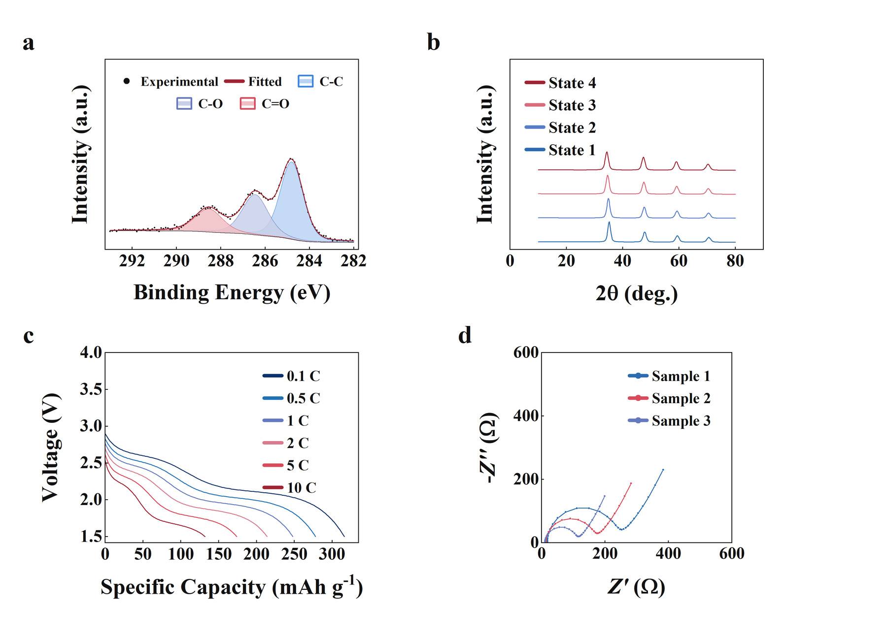<br/>**2×2 跨模态论文主图同页联动拼版** · `composite_figure` / `chart_grammar`<br/><sub>单页 MasterComposite (`1800×1298 px`)：`(a)` Pseudo-Voigt 多峰拟合与包络线 + `(b)` 四态衍射叠谱演化 + `(c)` `0.1 C–10 C` 顺序蓝红多倍率放电簇 + `(d)` `1 Ω = 1 Ω` 等比例 Nyquist 交流阻抗谱</sub> |
| :---: |

---

<a id="highlights"></a>

## 六大核心支柱 | Core Highlights

| 支柱 | 工程与科研审计机制 |
| :--- | :--- |
| **1. 6 大可插拔全科研领域包**<br/><sub>6 Pluggable Domain Packs</sub> | 统一覆盖**材料与电化学**（`.xls/.vms/.rasx/.ndax/.z60`）、**生物医学与多组学**（`.fcs/.mzml/.h5ad`）、**化学谱学与催化**（`.jdx/.dx/.jcamp`）、**物理光学与射频力学**（`.s1p/.s2p`）、**地球海洋环境**与 **AI4Science 模型评测**（`.jsonl`），自动完成格式嗅探、物理单位核验与领域审计。 |
| **2. 100% OriginPro 笛卡尔 + 非笛卡尔原生直出**<br/><sub>Zero-Matplotlib Native COM</sub> | 直接通过 `originpro` + `OriginExt` 无头会话构建 **100% 双击可编辑 `.opju` 工程**（支持常规 XY、双 Y、断轴、非线性公式联动顶轴、三元相图 `Ternary`、极坐标 `Polar`、多轴雷达图、多道地层剖面与二维矢量场箭头），同会话经 `expGraph`（`tr.Margin:=2`）直出 **`600 DPI` LZW `.tif`**、**`300 DPI .png`** 及**无损矢量 `.pdf`**。 |
| **3. 双套签名出版预设 × 9 种顶刊物理栏宽规格**<br/><sub>Dual Themes × 9 Journal Specs</sub> | 默认 [`style_publication_minimal`](./skills/sci-origin-pipeline/presets/style_publication_minimal.json)（`Times New Roman Bold`，`3.0 pt` 框/线）与轻量 [`style_arial_clean`](./skills/sci-origin-pipeline/presets/style_arial_clean.json)（`Arial Regular`，`1.5 pt` 细框 / `2.0 pt` 主线）一键切换；叠加 [`journal_specs.json`](./skills/sci-origin-pipeline/presets/journal_specs.json) 精确映射 `Nature`（`89/183 mm`）、`Science`（`55/184 mm`）、`Cell`（`85/174 mm`）、`ACS`（`3.25 in`）与 `IEEE`（`3.5 in`）印刷栏宽、字号层级与子图角标格式。 |
| **4. 像素锁定画布与 `4:3` 等比例 / `1:1` 矩阵几何对齐**<br/><sub>Pixel-Locked Canvas Geometry</sub> | 默认汇报画幅统一锁定 **`10.40 × 7.80 in`**（标准 `4:3` 外轮廓）：常规 1D 图表与 **EIS Nyquist 阻抗谱**统一采用 **`6.40 × 4.80 in`（`4:3`）标准矩形内框**（Nyquist 按 `ΔZ' : Δ(-Z'') = 4 : 3` 锁定 `1 Ω = 1 Ω` 等比例物理正圆弧，与常规 1D 图 0 像素框线偏差）；**二维连续云图、矢量场底图与相关性矩阵热力图**居中锁定 **`4.80 × 4.80 in` 严格 `1:1` 正方内框** + 右侧等高色标尺，上下黑框边沿（`0.95..5.75 in`）零像素错位。 |
| **5. 自动化假设检验、生存/ROC 与通用曲线拟合引擎**<br/><sub>Statistical &amp; Curve Rigor</sub> | 内置 [`stat_engine.py`](./skills/sci-origin-pipeline/scripts/stat_engine.py)（Shapiro-Wilk 正态性 + Levene 方差齐性自动路由 ANOVA/Tukey、Welch、Kruskal-Wallis/Mann-Whitney U + BH-FDR 多重校正，防碰撞分层显著性横杠，Kaplan-Meier Greenwood `cloglog` 置信带 + Mantel-Cox Log-rank / HR + 风险人数表，Hanley-McNeil AUROC 95% CI + Youden 最优截断点）与 [`curve_models.py`](./skills/sci-origin-pipeline/scripts/curve_models.py)（9 类模型含 4PL `IC50`、Michaelis-Menten、Arrhenius、Langmuir 及 Jacobian Delta-Method 95% 置信带 + `AIC/BIC`）。 |
| **6. 色盲安全/感知均匀色板与中英双语顶刊 Source Data**<br/><sub>Accessible Palettes &amp; EN/ZH XLSX</sub> | 除经典蓝红成对语义色板外，原生生成 **1052 字节 Microsoft RIFF `.pal`** 注入 `okabe_ito`（8 色色盲安全）、`tol_muted`（10 色多簇）与 `viridis` / `cividis` / `batlow` / `vik` 感知均匀色阶；同源导出符合 `Nature`/`Science`/`Cell` 投稿规范的英文或中文 **`Source_Data.xlsx`**（含 `Raw_Data`、`Summary_Statistics`、`Statistical_Tests` 精确 `p_raw/p_adj`、`Curve_Fit_Summary` 与 `Figure_Manifest`）。 |

---

<a id="gallery"></a>

## 全景全学科 OriginPro 原生合成画廊（43 图） | All-Science Native Gallery

> 全部 **43 张示例图**均由 [`examples/generate_synthetic_gallery.py`](./examples/generate_synthetic_gallery.py)（串联 Part 1–5 五大模块）基于确定性纯数学与统计模拟方程在 **Headless OriginPro 2024** 中实时渲染生成，零外部文件依赖、零私有实验数据。同行图表严格锁定一致长宽比，确保等宽排布零高度错位。

### Showcase I · 双套出版预设一键切换对照（`Times New Roman Bold` vs `Arial Regular`，4 图）

| 默认预设：`style_publication_minimal` (`Times New Roman Bold`) | 轻量预设：`style_arial_clean` (`style_preset: "arial"`) |
| :---: | :---: |
| <br/>**双 Y 轴相组成与保持率复合图** · `dual_y_combo`<br/><sub>`3.0 pt` 闭合粗框 · 左轴 100% 堆积柱 + 右轴语义染色点线 · 全高零点对齐</sub> | <br/>**双 Y 轴复合图（Arial 常规预设）** · `dual_y_combo`<br/><sub>`1.5 pt` 闭合细框 · `2.0 pt` 主线 · 全图常规无衬线字体像素级同坐标切换</sub> |
| <br/>**等比例 Nyquist 阻抗谱（新罗马加粗）** · `curve_with_inset`<br/><sub>`6.40×4.80 in` 标准 `4:3` 内框（`ΔZ':Δ(-Z'')=4:3` 实现 `1 Ω = 1 Ω` 等比） · 纯白底 `zoom` 内插层</sub> | 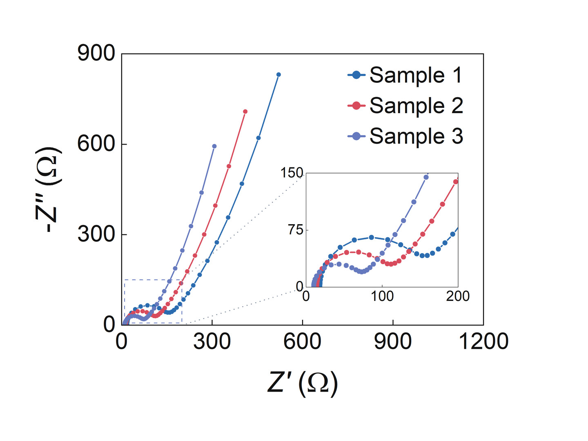<br/>**等比例 Nyquist 阻抗谱（Arial 常规）** · `curve_with_inset`<br/><sub>`1.0 pt` 内插细框 · `6.40×4.80 in` 标准 `4:3` 内框 `1 Ω = 1 Ω` 等比例锁定 · 与 1D 图零像素框线偏差</sub> |

---

### Showcase II · 仪器表征解析与物理约束分峰画廊（`Characterization & Deconvolution`，9 图）

| 表征与分峰示例 A（`4:3` 标准同画布 `1440×1080`） | 表征与分峰示例 B（`4:3` 标准同画布 `1440×1080`） |
| :---: | :---: |
| 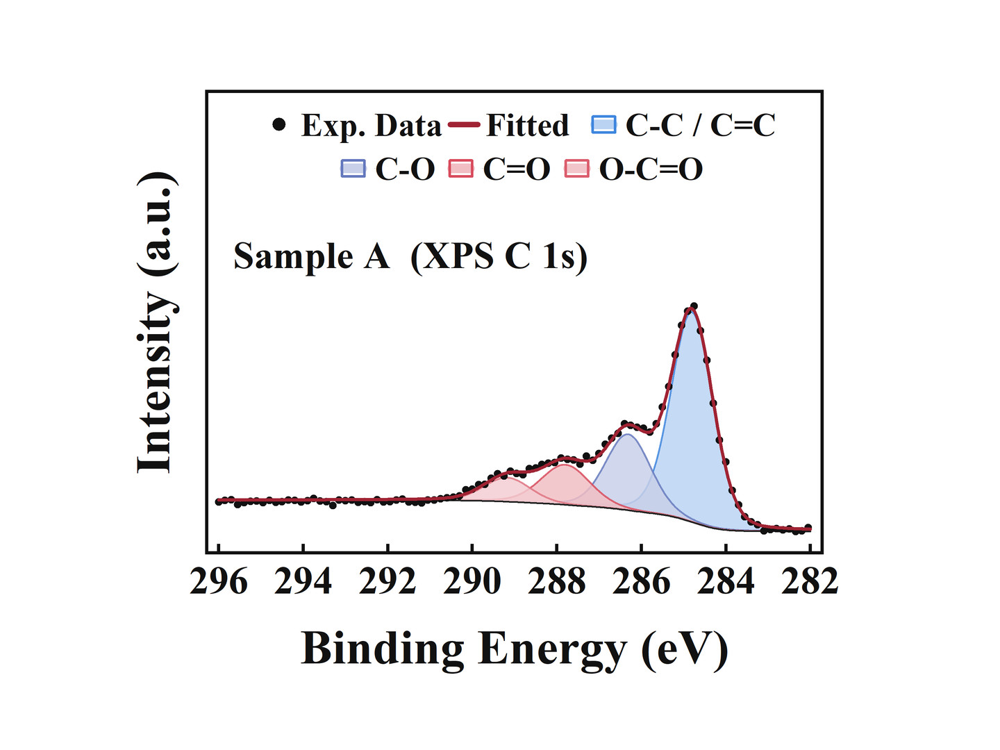<br/>**XPS C 1s 四峰物理约束分峰** · `deconvolve`<br/><sub>反演结合能横轴 (`296→282 eV`) · Shirley 非线性基线 · 半透明 Pseudo-Voigt 子峰</sub> | 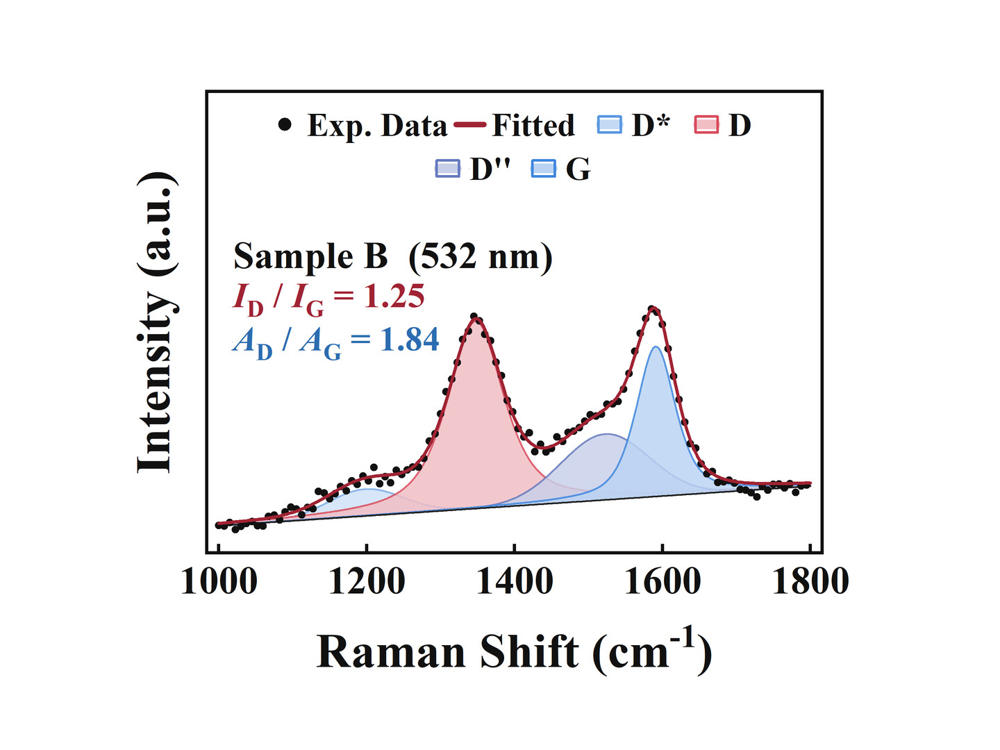<br/>**无序碳一阶 Raman 四峰拟合** · `deconvolve`<br/><sub>`D* / D / D'' / G` 物理约束分解 · 包络拟合实线 · 框内自动标注 `I_D / I_G` 比值</sub> |
| <br/>**五态物相演化 XRD 叠置瀑布图** · `waterfall`<br/><sub>蓝红顺序语义色阶 · 贯穿式衍射晶面竖向虚线导引 · 自动避让峰肩标注</sub> | <br/>**反演波数五态 FTIR 红外叠谱** · `waterfall`<br/><sub>`1800→600 cm⁻¹` 反演横轴 · 任意强度轴自动隐去冗余刻度 · 特征官能团虚线</sub> |
| <br/>**IV 型 N₂ 吸脱附等温线与孔径分布** · `bet_porosity`<br/><sub>实心吸附 / 白芯空心脱附滞后环 · 框内嵌套独立坐标 BJH `dV/dD` 孔径内插图</sub> | <br/>**激光粒度对数微分与累积分布** · `particle_size`<br/><sub>`Log10` 粒径横轴开启次刻度 · 微分体积分数与 `0–100%` 累积双 Y 轴 · `D10/D50/D90`</sub> |
| <br/>**顺磁共振一阶微分洛伦兹谱** · `epr_spectrum`<br/><sub>一阶导数 `dI/dB` 对称线型 · 过零中心场 `g = 2.0028` 竖向导引 · `ΔH_pp` 线宽标注</sub> | 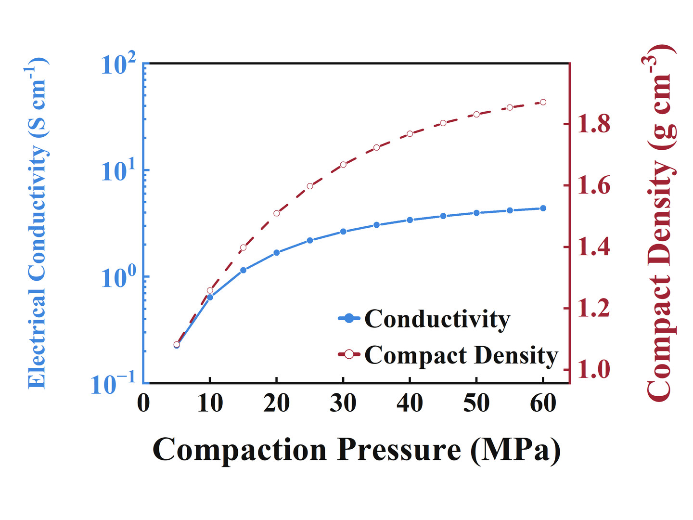<br/>**粉体压实压强–电导率与压实密度联动** · `conductivity`<br/><sub>`5–60 MPa` 连续加载 · 左轴电导率与右轴压实密度双 Y 轴联动与语义色绑定</sub> |

| <br/>**重叠多解谱区四候选模型敏感性与触界审查联图** · `model_sensitivity`<br/><sub>`2×2` `(a)–(d)` 多模型并排试算 (`1800×1538 px`) · 自动检出峰位触碰边界约束 (`CEN_BOUND`) 并量化组分面积比例波动区间</sub> |
| :---: |

---

### Showcase III · 电化学动力学、阻抗谱与原位二维场画廊（`Electrochemistry & Operando 2D`，7 图）

| 多倍率恒流放电 (`1440×1080`) | 高倍率短脉冲瞬态拆解 (`1440×1080`) | 双对数 Ragone 图 (`1440×1080`) |
| :---: | :---: | :---: |
| <br/>**七倍率恒流放电曲线簇** · `neware_galvanostatic`<br/><sub>`0.1 C–10 C` 深蓝至暗红顺序色阶 · 平台拐点与框内紧凑图注</sub> | <br/>**短脉冲时间归零与极化拆解** · `electrochem_kinetics`<br/><sub>脉冲起点 `t = 0` 对齐 · 欧姆压降 `ΔV₀` 与慢极化 `ΔV_slow` 跨度导引</sub> | 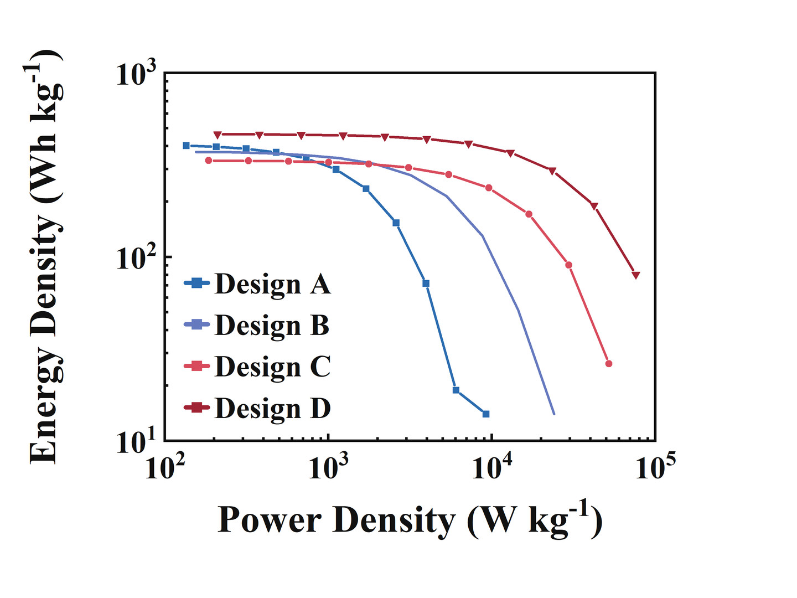<br/>**双对数能量–功率密度图** · `electrochem_kinetics`<br/><sub>`Log10–Log10` 主次内向刻度 · 四种电极架构功率保持率对比</sub> |

| EIS Bode 双层共享频率阻抗谱 (`1440×1080`) | 二维弛豫时间分布伪彩云图 (`1440×1080`) |
| :---: | :---: |
| 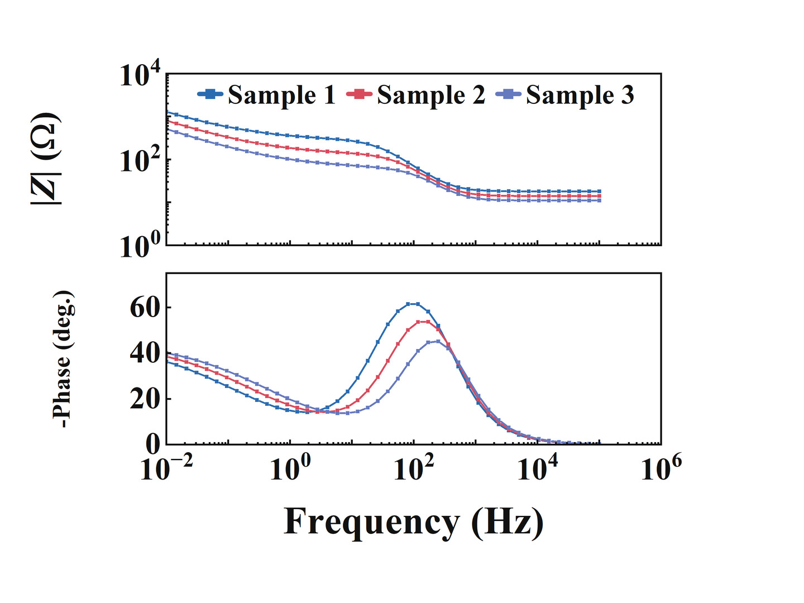<br/>**Bode 模值与相角上下双层联图** · `bode_dual_panel`<br/><sub>单页双 `GLayer` 外包络 `0.95..5.75 in` 对齐 · 共享 `Log10(Freq)` 横轴与顶层图注</sub> | <br/>**二维连续 DRT 弛豫时间分布云图** · `contour_pseudocolor_2d`<br/><sub>居中 `4.80×4.80 in` `1:1` 正方矩阵场 · `1052B RIFF .pal` 零本底纯白蓝红色板 · 64 阶原生色标尺</sub> |

| <br/>**恒流充放电曲线与 Savitzky-Golay 微分容量双面板联图** · `electrochem_kinetics` (`galvanostatic_dqdv`)<br/><sub>`1×2` 横向耦合画幅 (`1440×695 px`) · 左图充放电电压平台与右图平滑 `dQ/dV` 氧化还原特征峰竖向虚线一一对应</sub> |
| :---: |

| 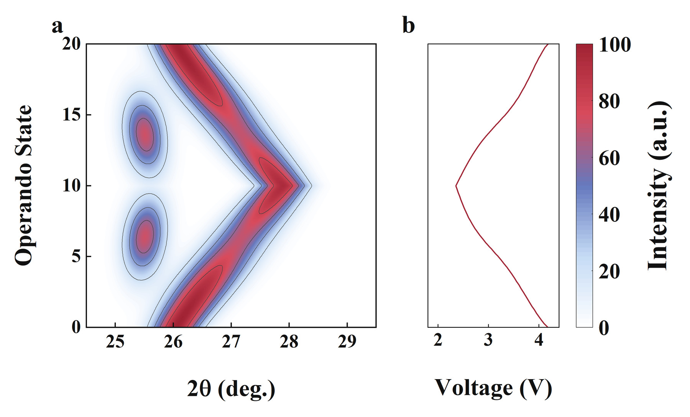<br/>**原位二维连续伪彩演化场与同步电化学状态曲线耦合图** · `contour_pseudocolor_2d` (`side_panel`)<br/><sub>双面板不等宽联动 (`1800×1089 px`) · 左侧零本底纯白蓝红原位二维强度场与右侧纵向状态–电压曲线严格共享状态纵轴</sub> |
| :---: |

---

### Showcase IV · 声明式统计分布、回归置信带与矩阵语法画廊（`Declarative Statistical & Matrix Grammar`，6 图）

| 声明式统计与分类语法 A（`4:3` `1440×1080`） | 声明式回归与矩阵语法 B（`4:3` `1440×1080`） |
| :---: | :---: |
| 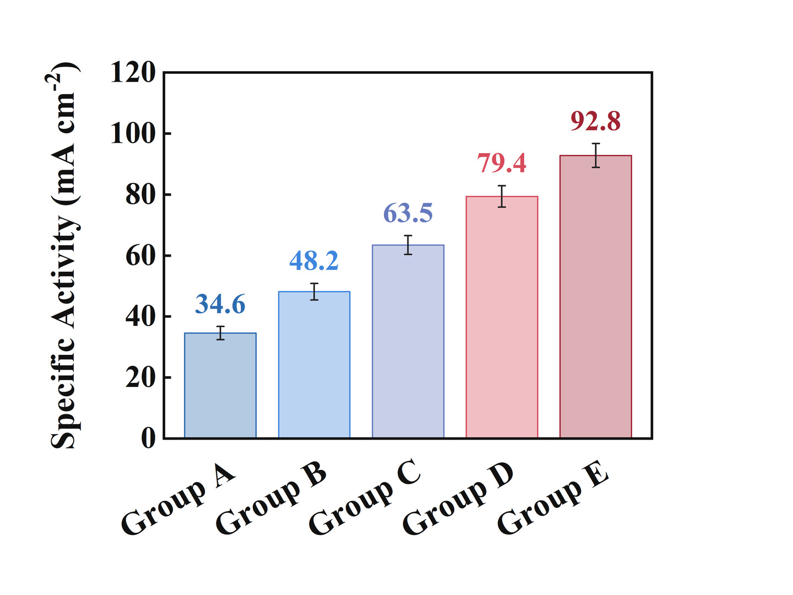<br/>**分组柔光柱状图与标准差误差棒** · `bar_grouped_gradient`<br/><sub>`1052B` 离散色板实填充 · `1.5 pt` 同系深色描边 · `SD` 误差棒与柱顶同色加粗数值</sub> | <br/>**四组分极化过电位绝对值堆积柱** · `bar_stacked`<br/><sub>底层惰性至顶层活性三明治语义色阶 · `0.8 pt` 纯白层间分隔线 · 框内顶置横排图注</sub> |
| <br/>**0–100% 归一化化学物种演化堆积柱** · `bar_stacked_100pct`<br/><sub>Y 轴上限留出纯净图注天际线且刻度严格截断于 `0..100`（零 `120%` 伪刻度残留）</sub> | 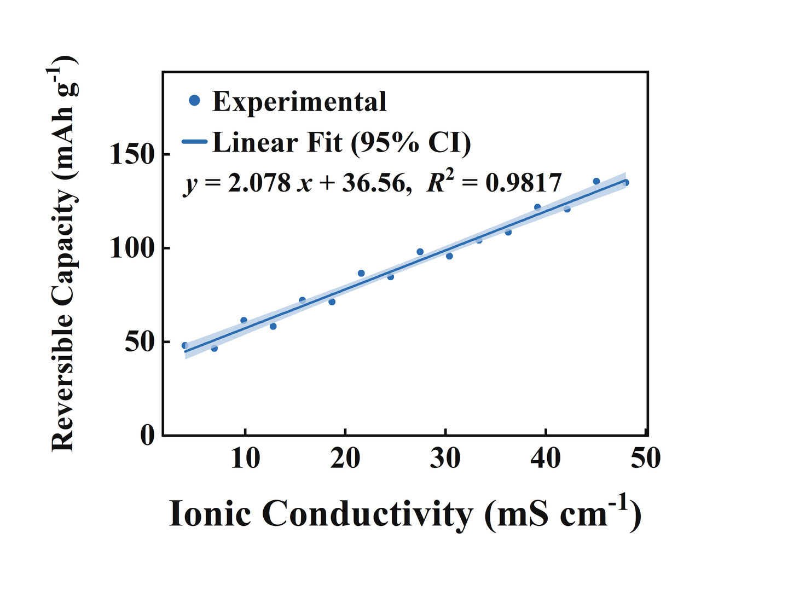<br/>**二维散点线性回归与 95% 置信阴影带** · `xy_fit_and_band`<br/><sub>纯 2D 圆点散点 · 半透明 95% 置信区间填充带 · 自动斜体排版回归方程与 `R²`</sub> |
| <br/>**多平行样 Tukey 箱线与对称抖动散点** · `stat_distribution`<br/><sub>柔光粉彩四分位箱体 · `3.0 pt` 中位粗横杠与 T 帽须线 · 确定性对称抖动实测圆点</sub> | 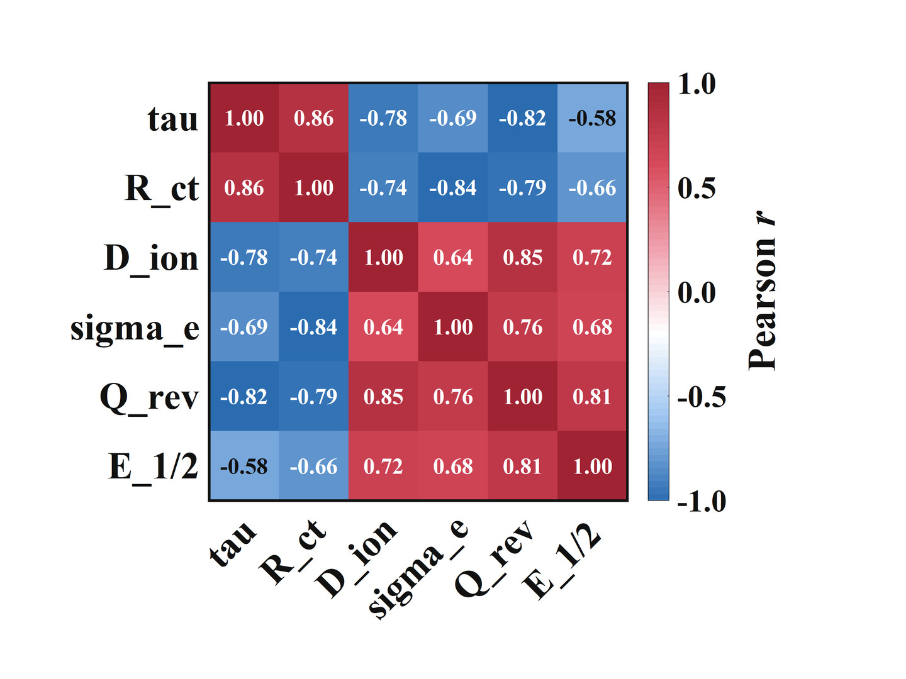<br/>**1:1 构效关系 6×6 相关性矩阵热力图** · `matrix_heatmap`<br/><sub>居中 `4.80×4.80 in` `1:1` 正方内框 · 蓝–白–红发散色板 · `0.8 pt` 白格线与自适应字色数值</sub> |

---

### Showcase V · 生物医学、多组学、临床生存与药理剂量响应画廊（`Biomedicine, Omics, Clinical & Pharmacology`，6 图）

| 生物统计、组学与临床生存 A（`4:3` `1440×1080`） | 细胞分群、药理拟合与诊断评估 B（`4:3` `1440×1080`） |
| :---: | :---: |
| 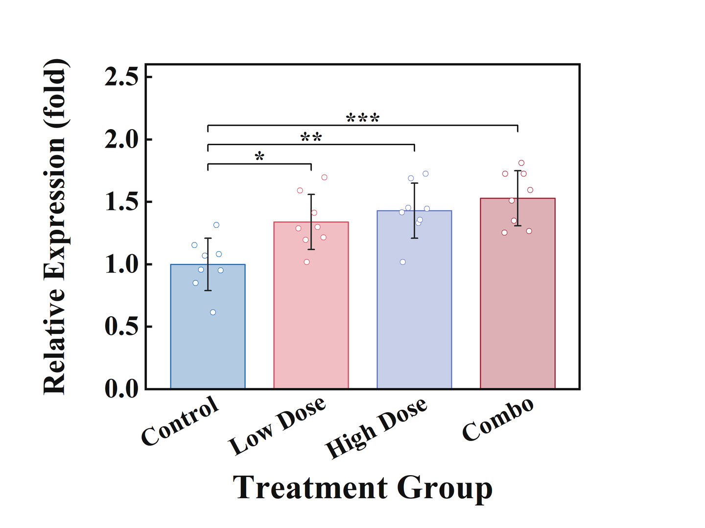<br/>**多组均值柱叠加个体散点与显著性星号** · `stat_bar_dot_sig` (`TNR Bold`)<br/><sub>均值±SD 描边柱 + 白芯实测平行样圆点 · One-way ANOVA / Tukey HSD 自动分层 `* / ** / ***` 横杠</sub> | 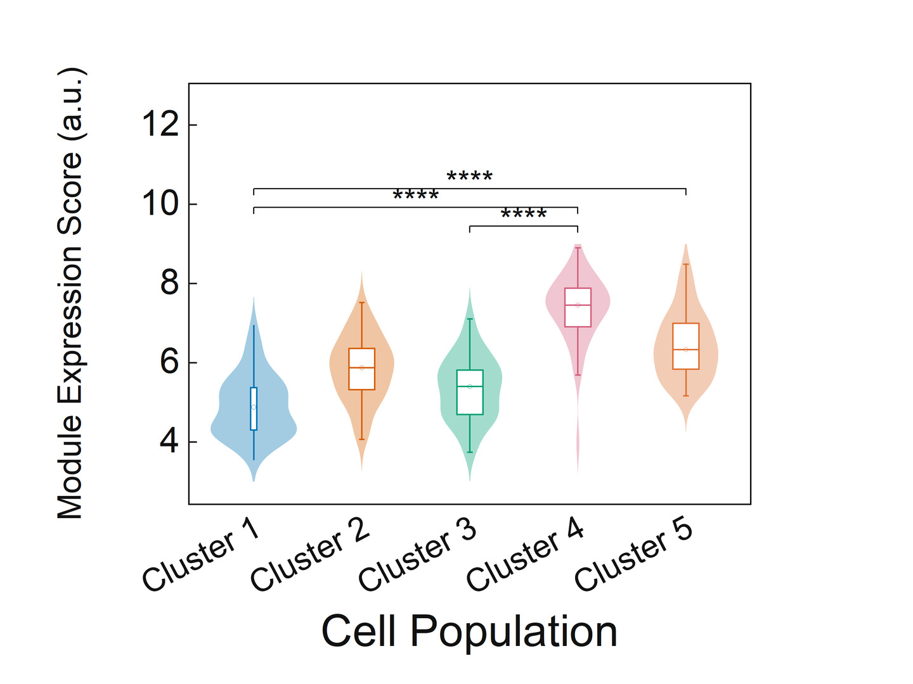<br/>**五亚群核密度小提琴图（色盲安全预设）** · `stat_violin_raincloud` (`Arial` + `okabe_ito`)<br/><sub>Origin 原生 Violin KDE + 内嵌纯白四分位箱体 · Okabe-Ito 色盲友好色板与多重检验横杠</sub> |
| 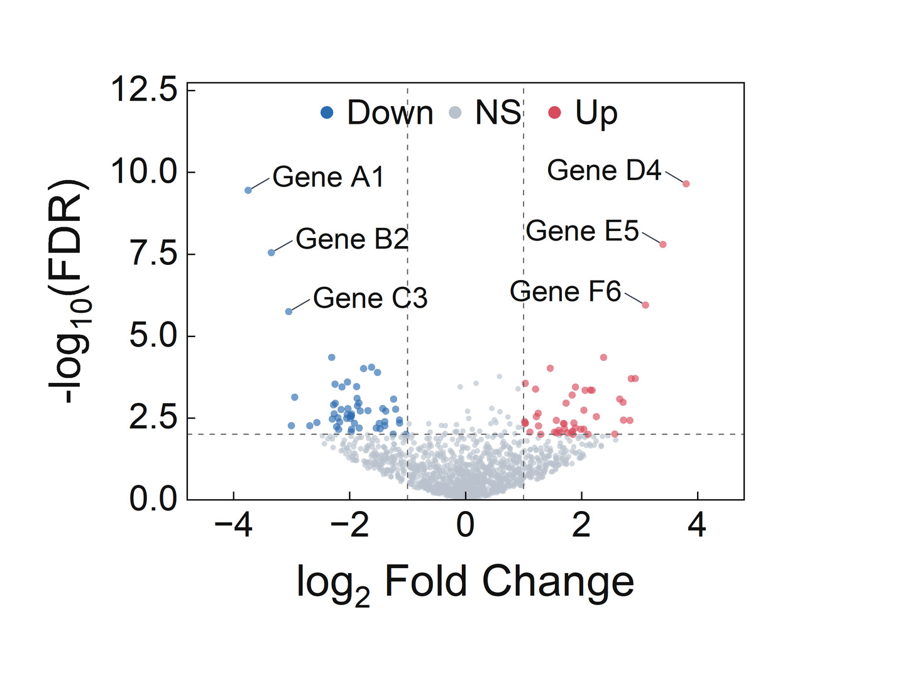<br/>**转录组差异表达火山图与无碰撞引线** · `volcano_plot` (`Arial`)<br/><sub>`Down / NS / Up` 三态散点 · `±1.0 log₂FC` 与 `p = 0.01` 阈值虚线 · Top 标志基因双翼折线标注</sub> | 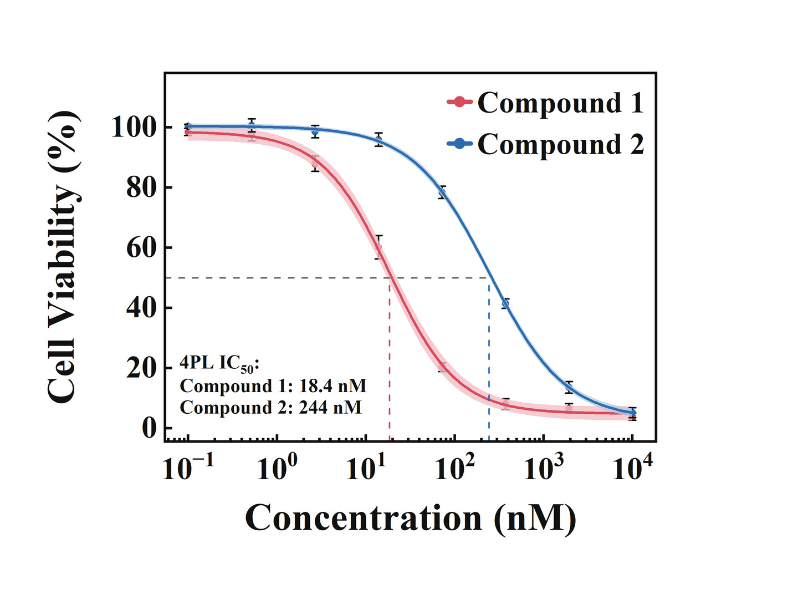<br/>**双抑制剂四参数逻辑斯蒂剂量响应曲线** · `dose_response_4pl` (`TNR Bold`)<br/><sub>`Log10` 浓度轴 4PL S 型拟合 + Delta-Method 95% 置信带 · `50%` 抑制率与 `IC₅₀` 垂落虚线导引</sub> |
| 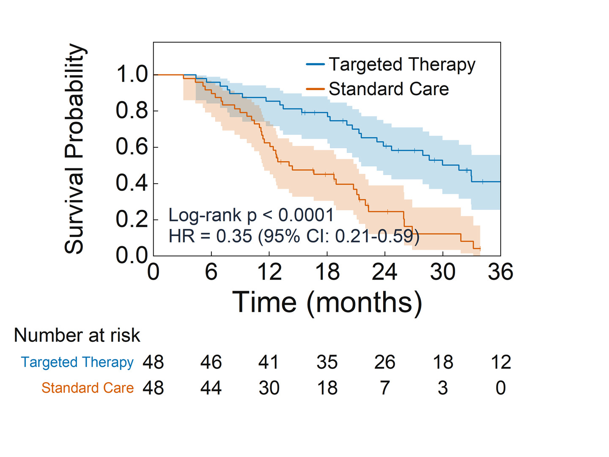<br/>**临床双队列生存曲线与风险人数表** · `kaplan_meier_plot` (`Arial` + `okabe_ito`)<br/><sub>Step-Horz 阶梯生存率 + Greenwood `cloglog` 95% CI 带 + 右删失竖线 · Mantel-Cox `p / HR` 与对齐 `Number at risk` 表</sub> | 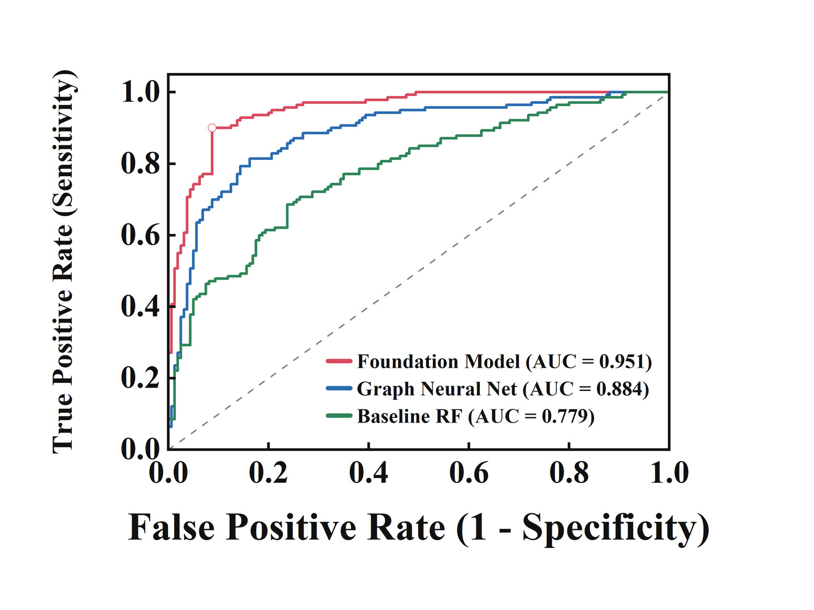<br/>**多模型受试者工作特征曲线与最优截断点** · `roc_pr_curve` (`TNR Bold`)<br/><sub>三分类器 ROC 对比 · Hanley-McNeil `AUROC ± 95% CI` 图注 · 随机对角虚线与白芯圆点 Youden 最佳阈值</sub> |

---

### Showcase VI · 化学催化、核磁波谱、三元相图与超快/光学物理画廊（`Chemistry, Catalysis, Ultrafast & Optical Physics`，6 图）

| 催化热力学、核磁波谱与相图 A（`4:3` `1440×1080`） | 超快断轴动力学、非线性双 X 轴与极坐标 B（`4:3` `1440×1080`） |
| :---: | :---: |
| 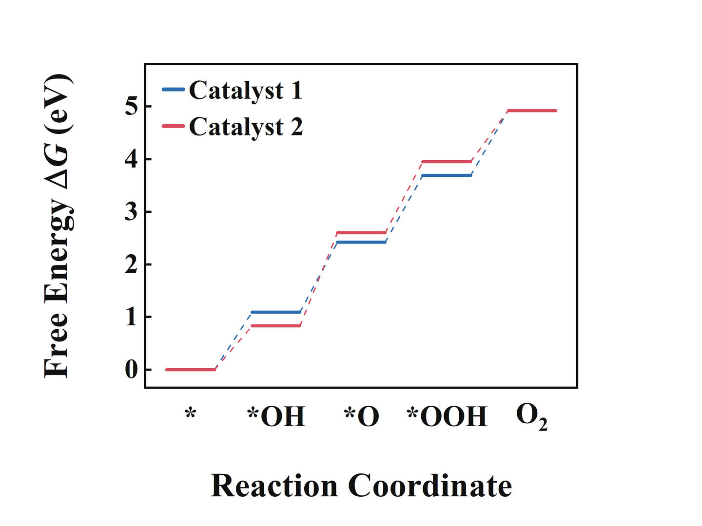<br/>**电催化五步自由能台阶反应路径图** · `free_energy_diagram` (`TNR Bold`)<br/><sub>双催化剂 `* → *OH → *O → *OOH → O₂` 演化 · 加粗水平能级平台与细虚线跃迁连接</sub> | 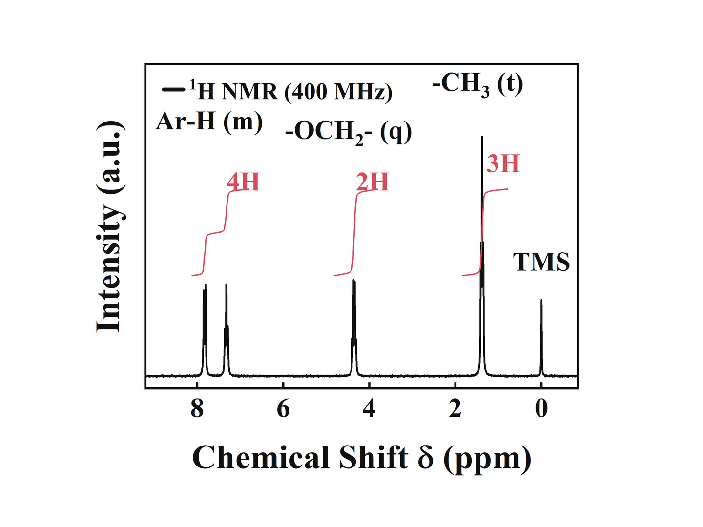<br/>**核磁共振氢谱与抬升阶梯积分曲线** · `nmr_spectrum` (`TNR Bold`)<br/><sub>`9.0→0.0 ppm` 反演化学位移横轴 · 悬空阶梯积分曲线 (`4H / 2H / 3H`) · 多重峰裂分归属标注</sub> |
| 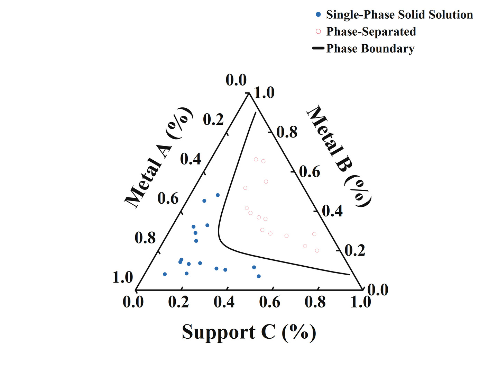<br/>**三组分催化/合金归一化三元相图** · `ternary_diagram` (`TNR Bold`)<br/><sub>Origin 原生 `Ternary` 坐标系 (`A + B + C = 100%`) · 单相固溶区、两相分离区与双节相界连线</sub> | 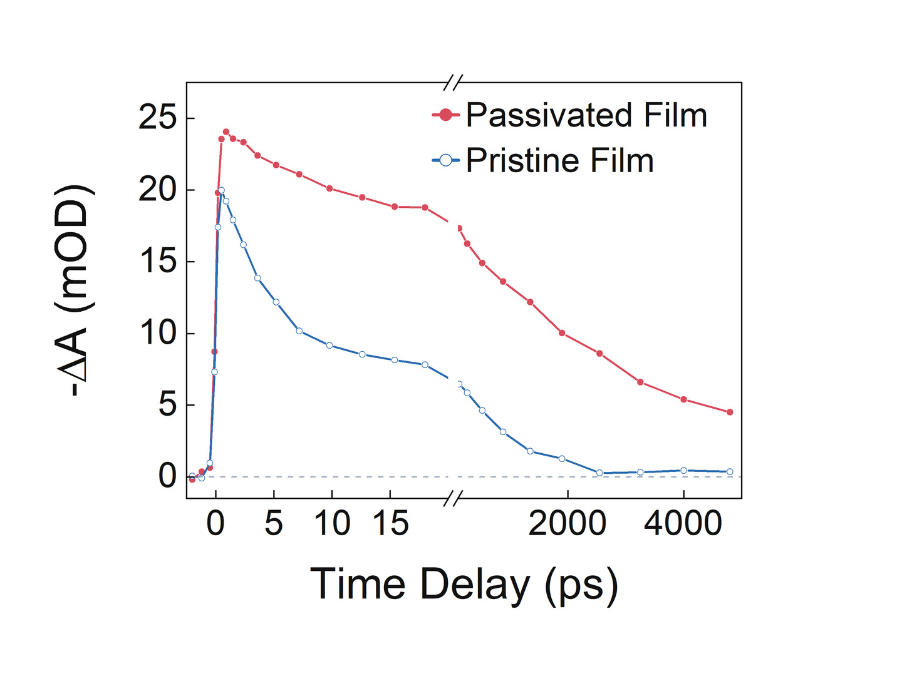<br/>**超快瞬态吸收跨尺度断轴动力学** · `broken_axis_plot` (`Arial`)<br/><sub>原生 X 轴断点 (`20..100 ps`) 同图衔接飞秒热载流子快衰减 (`-2..18 ps`) 与纳秒长寿命态 (`120..4800 ps`)</sub> |
| 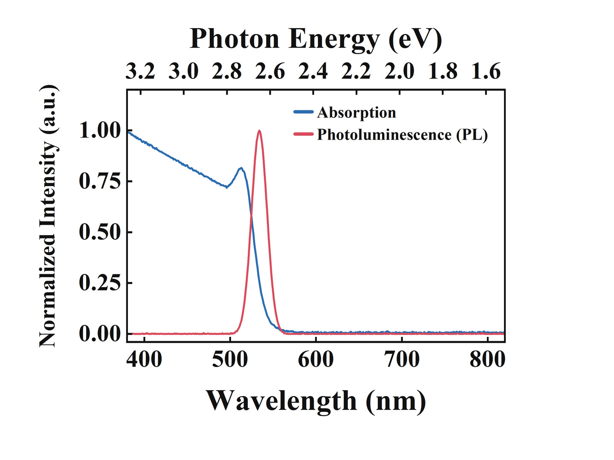<br/>**半导体吸收/荧光光谱与光子能量非线性双 X 轴** · `dual_x_optical_spectrum` (`TNR Bold`)<br/><sub>底轴波长 `Wavelength (nm)` 与顶轴光子能量 `Photon Energy (eV)` 经 `1239.84 / x` 严格公式联动</sub> | 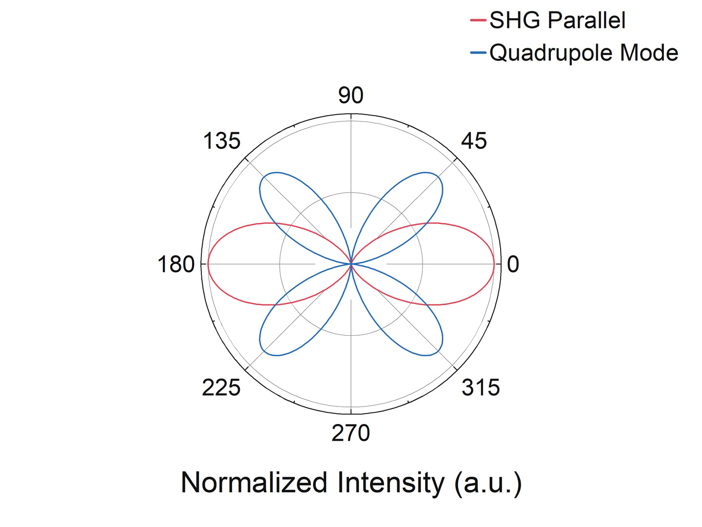<br/>**光学偏振/偶极辐射角分布极坐标图** · `polar_radar_plot` (`Arial`)<br/><sub>Origin 原生 `0–360°` 极坐标系 (`BBUTN1` 零残留) · 二倍频偶极双瓣与四极子四瓣辐射方向图</sub> |

---

### Showcase VII · AI4Science 消融/雷达评估、地学多道测井与二维矢量场画廊（`AI4Science, Earth Profiles & 2D Vector Fields`，4 图）

| AI4Science 模型评估与多维基准 A（`4:3` `1440×1080`） | 地学多道地层剖面与二维物理矢量场 B（`4:3` `1440×1080`） |
| :---: | :---: |
| 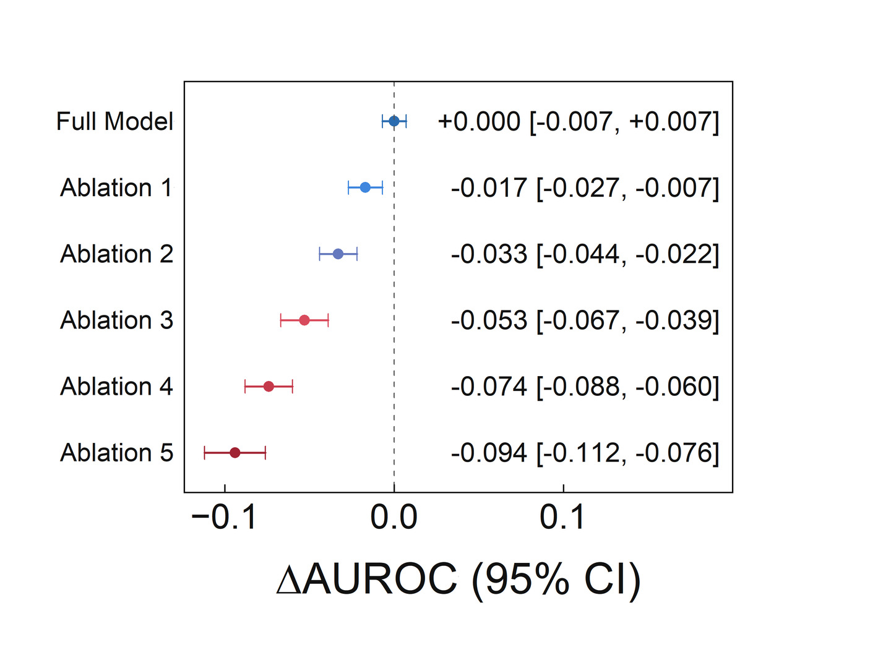<br/>**机器学习消融实验效应量与置信区间森林图** · `forest_ablation_plot` (`Arial`)<br/><sub>倒序分类纵轴 · 双端帽水平 95% CI 误差杠 + 2D 点估计 · `0.0` 零效参考虚线与右侧定量区间列</sub> | 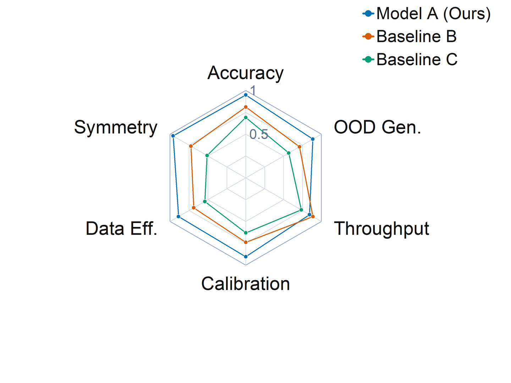<br/>**AI4Science 基础模型六维能力雷达图** · `polar_radar_plot` (`radar`, `Arial` + `okabe_ito`)<br/><sub>等比例正六边形同心蛛网网格 · 六项核心指标极向轴 · 半透明色盲安全多边形填充叠合</sub> |
| 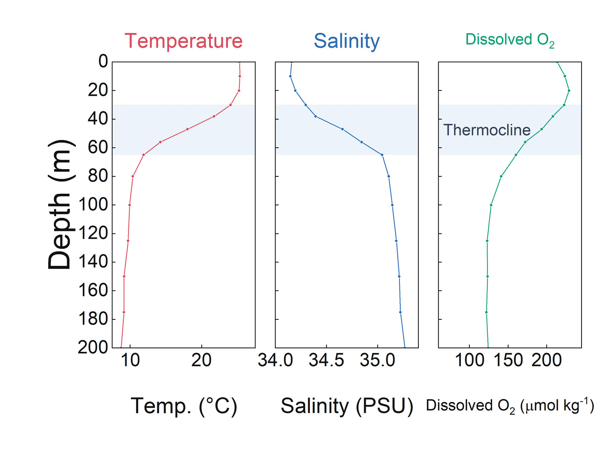<br/>**海洋/古气候三道同步深度剖面联图** · `multi_track_profile` (`Arial`)<br/><sub>温度、盐度与溶解氧三道并排共享反演深度纵轴 (`0→200 m`) · 跨道贯穿式温跃层阴影层位带</sub> | 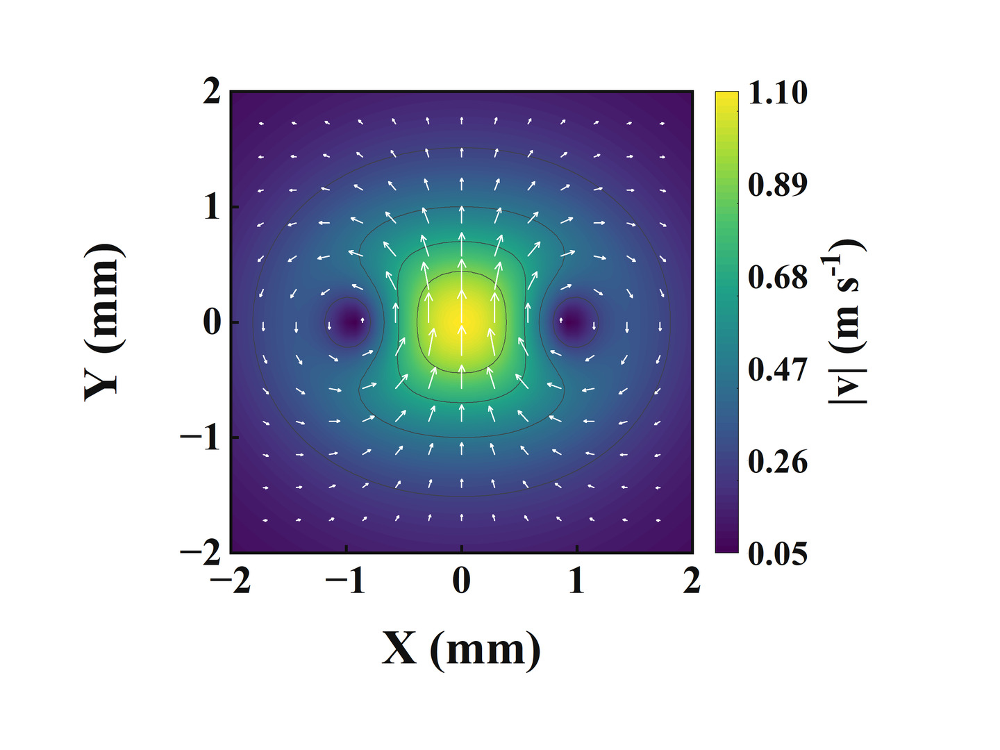<br/>**二维双涡旋/斯格明子速度矢量场叠加图** · `vector_quiver_field` (`TNR Bold` + `viridis`)<br/><sub>居中 `4.80×4.80 in` `1:1` 场域 · `viridis` 感知均匀速度模值底图 + 原生等比 2D 矢量箭头 + 色标尺</sub> |

---

<a id="modes"></a>

## 41 种科研分析与声明式全学科图型模式速查表 | Supported Modes

### A. 仪器表征解析、电化学与物理约束分峰管线（14 种，`Domain Pipelines`）

| # | 模式 (`mode`) | 适用表征与输入格式 | 核心交付产物 | 示例图 (`Preview`) |
| :---: | :--- | :--- | :--- | :--- |
| 01 | `raw_preview` | XPS / Raman / 陌生谱区原谱快速侦察 (`.xls/.xlsx/.txt/.csv`) | 信噪比 `SNR` 审计 + 原谱 `.opju` / `.tif` | [XPS 谱区示例](./assets/gallery/demo_xps_deconv.jpg) |
| 02 | `deconvolve` | XPS / Raman 物理约束 Pseudo-Voigt 分峰（Shirley / Linear 基线） | 含基线分峰 `.opju` + 双口径比例汇总 `.xlsx` | [XPS C 1s](./assets/gallery/demo_xps_deconv.jpg) · [Raman](./assets/gallery/demo_raman_deconv.jpg) |
| 03 | `model_sensitivity` | 严重重叠谱区多候选模型并排试算与参数触界 (`CEN_BOUND`) 审查 | `(a)–(d)` 对照联图 + 敏感度波动表 `.xlsx` | [2×2 四模型联图](./assets/gallery/demo_model_sensitivity.jpg) |
| 04 | `batch_deconvolve` | 多样品 × 多微区平行样去尖峰、批量分峰与 `均值±SD` 聚合 | 多面板分峰网格 `.opju` + 统计汇总总表 `.xlsx` | [多模型网格](./assets/gallery/demo_model_sensitivity.jpg) · [平行样分布](./assets/gallery/demo_box_jitter.jpg) |
| 05 | `replot_deconv` | 读取已有分峰结果表一键重绘统一出版样式（不擅自重拟合） | 标准双预设 `.opju` + `600 DPI LZW .tif` | [Raman 四峰重绘](./assets/gallery/demo_raman_deconv.jpg) |
| 06 | `waterfall` | XRD (`.rasx/.asc/.txt`)、FTIR (`.csv/.spa/.jdx`)、Raman 多谱叠置瀑布图 | 自动错位峰标与特征虚线 `.opju` + 原始/偏移双表 | [XRD 叠谱](./assets/gallery/demo_xrd_waterfall.jpg) · [FTIR 叠谱](./assets/gallery/demo_ftir_waterfall.jpg) |
| 07 | `nyquist` | EIS 交流阻抗谱 (`.txt/.z60/.csv/.cor`) | 标准 `6.40×4.80 in` (`4:3`) 主框 `1 Ω = 1 Ω` 等比例弧 + 高频放大内插 `.opju` | [TNR 预设](./assets/gallery/demo_nyquist_tnr.jpg) · [Arial 预设](./assets/gallery/demo_nyquist_arial.jpg) |
| 08 | `bet_porosity` | $\text{N}_2$ 吸脱附等温线 + BJH/DFT 孔径分布 (`.csv/.xlsx/.qps`) | 实/空心滞后环主图 + BJH 嵌套内插图 `.opju` | [N₂ 等温线+BJH](./assets/gallery/demo_bet_porosity.jpg) |
| 09 | `particle_size` | 激光粒度体积微分与累积分布 (`.xls/.xlsx`) | `Log10` 横轴 + 微分/累积双 Y 轴 `.opju` + $D_{10}/D_{50}/D_{90}$ | [对数双Y粒度](./assets/gallery/demo_particle_size.jpg) |
| 10 | `epr_spectrum` | 电子顺磁共振一阶微分谱 (`.asc/.dsc/.dta`) | 过零中心 $g$ 因子与 $\Delta H_{\text{pp}}$ 线宽标注 `.opju` | [一阶微分 EPR](./assets/gallery/demo_epr_derivative.jpg) |
| 11 | `conductivity` | 粉体压实密度与电导率联动测试 (`.xlsx/.xls`) | 压强–电导率/压实密度双 Y 轴 `.opju` + 电阻率汇总 | [压实电导率双Y](./assets/gallery/demo_conductivity_pressure.jpg) |
| 12 | `neware_galvanostatic` | 恒流充放电与多倍率测试（支持 `.csv/.ndax/.nda` 直读） | 倍率曲线簇 `.opju` + 质量缺项安全降级核验 | [7 倍率放电簇](./assets/gallery/demo_rate_galvanostatic.jpg) |
| 13 | `xy_trend` | 通用多序列定量点线、顺序演化或对数趋势对比 | 自动最空角框内无框图注 `.opju` + `.xlsx` | [倍率趋势](./assets/gallery/demo_rate_galvanostatic.jpg) · [Ragone](./assets/gallery/demo_ragone_loglog.jpg) |
| 14 | `composite_figure` | 多模态论文主图拼版（如 `2×2` 光谱 + 衍射 + 倍率 + 等比例 EIS） | 同行等高 `MasterComposite` 首页 + 独立子图文件夹 | [2×2 多模态主图](./assets/gallery/demo_hero_composite_2x2.jpg) |

### B. 声明式通用全学科图型语法引擎（27 种，`Universal Declarative Chart Grammar`）

| # | 模式 (`mode`) | 典型科研场景与 OriginPro 原生视觉工艺 | 示例图 (`Preview`) |
| :---: | :--- | :--- | :--- |
| 01 | `bar_grouped_gradient` | 单指标多样品或簇状分组柱状图（柔光实填充 + `1.5 pt` 同系深色边框 + `SD` 误差棒 + 柱顶同色数值） | [分组误差柱状图](./assets/gallery/demo_bar_grouped_gradient.jpg) |
| 02 | `bar_stacked` | 绝对值多组分堆积柱状图（三明治扁平语义色阶 + `0.8 pt` `#FFFFFF` 层间白线，禁用逐段花哨渐变） | [极化绝对值堆积](./assets/gallery/demo_bar_stacked_abs.jpg) |
| 03 | `bar_stacked_100pct` | `0–100%` 归一化百分比堆积柱（顶部自动留出框内图注净空且 Y 轴主刻度严格截断于 `0..100`） | [100% 物种演化柱](./assets/gallery/demo_bar_stacked_100pct.jpg) |
| 04 | `dual_y_combo` | 左轴堆积柱/柱状图 + 右轴多指标点线双 Y 轴复合图（全高零基线对齐 + 右轴与标题语义染色绑定） | [TNR 双Y](./assets/gallery/demo_dual_y_tnr.jpg) · [Arial 双Y](./assets/gallery/demo_dual_y_arial.jpg) |
| 05 | `curve_with_inset` | 主曲线簇 + `zoom` 局部放大选框或独立 `subchart` 内插层（支持 `6.40×4.80 in` `4:3` 标准框内 `1 Ω = 1 Ω` 等比例锁定与白底遮罩） | [Nyquist 放大](./assets/gallery/demo_nyquist_tnr.jpg) · [BET 内插](./assets/gallery/demo_bet_porosity.jpg) |
| 06 | `electrochem_kinetics` | 统一电化学动力学语法：`pulse_align`（短脉冲归零压降拆解）、`galvanostatic_dqdv`（充放电 + `dQ/dV` 联图）、`ragone`（双对数） | [短脉冲](./assets/gallery/demo_pulse_align.jpg) · [dQ/dV](./assets/gallery/demo_dqdv_coupled.jpg) · [Ragone](./assets/gallery/demo_ragone_loglog.jpg) |
| 07 | `contour_pseudocolor_2d` | 居中 `4.80×4.80 in` `1:1` 二维连续伪彩云图（零本底纯白蓝红 `RIFF .pal` + 右侧 64 阶原生色标尺 + 可选 `side_panel` 联动） | [2D DRT](./assets/gallery/demo_drt_contour.jpg) · [原位联动](./assets/gallery/demo_operando_contour_side.jpg) |
| 08 | `xy_fit_and_band` | 二维散点 + 9 类通用曲线回归（`linear/poly/power/exp/arrhenius/michaelis_menten/langmuir` 等）+ 95% CI 带 + 斜率三角标注 | [回归+95%置信带](./assets/gallery/demo_xy_fit_band.jpg) |
| 09 | `bode_dual_panel` | EIS Bode 单页上下双层联图（上层 `\|Z\|` 双对数带共享图注，下层 `-Phase` 半对数共享频率横轴） | [Bode 双层阻抗](./assets/gallery/demo_bode_dual_panel.jpg) |
| 10 | `stat_distribution` | Tukey 五数概括粉彩箱线图 + 中位粗横杠 + T 帽须线 + 确定性对称抖动平行样实测散点 | [Tukey 箱线抖动](./assets/gallery/demo_box_jitter.jpg) |
| 11 | `matrix_heatmap` | 居中 `4.80×4.80 in` `1:1` 正方形相关性/参数矩阵热力图 + `0.8 pt` 纯白网格 + 自适应黑白对比字色数值 | [6×6 相关性热图](./assets/gallery/demo_matrix_heatmap.jpg) |
| 12 | `chart_grammar` | 支持任意 `nrows × ncols` 不等宽网格（`width_ratios` / `height_ratios`）与多图层自由叠加的底层声明式入口 | [2×2 声明式拼版](./assets/gallery/demo_hero_composite_2x2.jpg) |
| 13 | `stat_bar_dot_sig` | 生物/医药多组均值±SD/SEM 描边柱 + 个体平行测点抖动圆点 + 正态/方差齐性自动检验与防碰撞显著性星号横杠 | [均值柱+散点+星号](./assets/gallery/demo_bio_bar_dot_sig.jpg) |
| 14 | `stat_violin_raincloud` | 多亚群 Origin 原生 Violin 核密度分布 + 内嵌四分位白盒 + 色盲安全色板与多重检验星号横杠 | [五亚群小提琴图](./assets/gallery/demo_bio_violin_okabe.jpg) |
| 15 | `volcano_plot` | 组学差异表达火山图（`Down / NS / Up` 三态散点 + `log₂FC` 与 `p/FDR` 阈值虚线 + Top 基因双翼防碰撞折线标注） | [转录组火山图](./assets/gallery/demo_omics_volcano.jpg) |
| 16 | `dose_response_4pl` | 单/多化合物对数浓度 4 参数逻辑斯蒂（4PL）S 型剂量响应曲线 + Delta-Method 95% CI 带 + `IC₅₀` 垂落虚线 | [双抑制剂 4PL IC50](./assets/gallery/demo_pharma_ic50_4pl.jpg) |
| 17 | `free_energy_diagram` | 多催化剂/反应路径吉布斯自由能台阶图（加粗水平能级平台 + 细虚线跃迁连接 + 可选 `TS‡` B 样条鞍点曲线） | [五步 OER 自由能图](./assets/gallery/demo_chem_free_energy.jpg) |
| 18 | `forest_ablation_plot` | 临床亚组效应量 / AI4Science 消融实验水平森林图（95% CI 横杠 + 点估计 + 零效参考虚线 + 右侧区间数值列） | [六变体消融森林图](./assets/gallery/demo_ml_forest_ablation.jpg) |
| 19 | `kaplan_meier_plot` | 临床/可靠性阶梯生存曲线（Greenwood `cloglog` 95% CI 带 + 右删失竖线 + Mantel-Cox `Log-rank p / HR` + 刻度对齐风险人数表） | [KM 生存曲线+风险表](./assets/gallery/demo_clinical_kaplan_meier.jpg) |
| 20 | `roc_pr_curve` | 多分类器 ROC（Hanley-McNeil `AUROC ± 95% CI` + Youden 最优截断空心点）或 Precision-Recall（`AUPRC` + 阳性率基线）曲线 | [多模型 ROC 曲线](./assets/gallery/demo_ml_roc_curves.jpg) |
| 21 | `nmr_spectrum` | `¹H / ¹³C` 核磁共振化学位移谱（反演 `ppm` 横轴 + 抬升悬空阶梯积分曲线 + 多重峰裂分与积分氢数标注） | [¹H NMR 氢谱+积分](./assets/gallery/demo_chem_nmr_spectrum.jpg) |
| 22 | `broken_axis_plot` | 原生 Origin X/Y 跨量级断轴图（`layer.x/y.breaks`，支持超快瞬态双时域衰减、高低浓度跨尺度点线或分组柱） | [超快瞬态断轴图](./assets/gallery/demo_physics_broken_x_ta.jpg) |
| 23 | `dual_x_optical_spectrum` | 非线性公式联动双 X 轴光谱/动力学图（如底轴波长 `nm` 联动顶轴光子能量 `1239.84/x eV`，或温度 `K` 联动 `1000/T`） | [波长–eV 双X光谱](./assets/gallery/demo_optics_uvvis_ev_topx.jpg) |
| 24 | `ternary_diagram` | 三组分归一化（`A + B + C = 100%`）原生 `Ternary` 三元相图/组成图（自动闭合校验、三边旋转轴标题与相界连线） | [三元催化相图](./assets/gallery/demo_chem_ternary_phase.jpg) |
| 25 | `polar_radar_plot` | 原生极坐标角分布图（`subtype="polar"`，`0–360°` 辐射/各向异性）与多维能力评估雷达图（`subtype="radar"`，半透明多边形蛛网） | [光学极坐标](./assets/gallery/demo_optics_polar_radiation.jpg) · [六维雷达图](./assets/gallery/demo_ml_radar_benchmark.jpg) |
| 26 | `multi_track_profile` | 地学钻孔测井 / 海洋 CTD / 古气候多道并排同步深度或年代剖面（共享反演纵轴 + 跨道贯穿式阴影层位带 `horizons`） | [三道海洋深度剖面](./assets/gallery/demo_geo_multitrack_depth.jpg) |
| 27 | `vector_quiver_field` | 居中 `4.80×4.80 in` `1:1` 二维空间矢量场（原生等比 `26°` V 型 2D 矢量箭头叠加标量伪彩云图或自动速度模值场 + 右侧色标尺） | [二维涡旋矢量场](./assets/gallery/demo_physics_vector_quiver.jpg) |

---

<a id="packs-journals"></a>

## 6 大可插拔学科包与顶刊印刷栏宽矩阵 | Domain Packs &amp; Journal Specs

### 1. 6 大可插拔学科扩展包（`skills/sci-origin-pipeline/scripts/packs/`）

| 学科包 ID (`pack_id`) | 覆盖学科与典型模态 | 原生嗅探与直读扩展名 | 典型推荐模式 (`recommended_modes`) |
| :--- | :--- | :--- | :--- |
| `materials_electrochem` | 材料表征（XPS/Raman/XRD/FTIR/BET/EPR/粒度）与电化学储能 | `.xls/.xlsx/.vms/.vgd/.rasx/.asc/.spa/.z60/.cor/.ndax/.nda/.dsc/.dta/.qps` | `deconvolve`, `waterfall`, `nyquist`, `neware_galvanostatic`, `electrochem_kinetics`, `contour_pseudocolor_2d` |
| `biomed_omics` | 生物医学平行样统计、临床生存队列、转录/蛋白组学、流式与单细胞元数据 | `.fcs`, `.mzml`, `.h5ad`, `.csv`, `.tsv`, `.xlsx` | `stat_bar_dot_sig`, `stat_violin_raincloud`, `volcano_plot`, `dose_response_4pl`, `kaplan_meier_plot`, `roc_pr_curve` |
| `chem_catalysis` | 化学结构波谱（JCAMP-DX NMR/IR/UV-Vis）、电/热催化反应自由能与动力学 | `.jdx`, `.dx`, `.jcamp`, `.csv`, `.tsv`, `.xlsx` | `nmr_spectrum`, `free_energy_diagram`, `xy_fit_and_band`, `waterfall` |
| `physics_optics_mech` | 超快光谱、光学/光子学（`nm ↔ eV`）、射频 S 参数网络与固体应力–应变力学 | `.s1p`, `.s2p`, `.csv`, `.tsv`, `.txt`, `.xlsx` | `dual_x_optical_spectrum`, `polar_radar_plot`, `broken_axis_plot`, `xy_fit_and_band` |
| `geo_env` | 地球化学三元物相闭合校验、海洋 CTD / 地层多道测井与二维大气/流场 | `.csv`, `.tsv`, `.xlsx` | `ternary_diagram`, `multi_track_profile`, `vector_quiver_field`, `contour_pseudocolor_2d` |
| `ml_ai4s` | 机器学习训练日志流、消融实验置信区间、诊断分类评分与多维基准评测 | `.jsonl`, `.csv`, `.tsv`, `.xlsx` | `forest_ablation_plot`, `roc_pr_curve`, `polar_radar_plot`, `xy_fit_and_band` |

### 2. 9 种顶刊物理印刷栏宽矩阵（`presets/journal_specs.json`）

通过 CLI `--journal-spec <spec_id>` 或在任务 JSON 配置中指定 `"journal_spec"`，引擎会自动按目标期刊栏宽等比缩放 Origin 物理画布、内框坐标、框线/曲线磅值、点径、四级字号与子图角标大小写：

| 规格 ID (`journal_spec`) | 目标期刊 / 场景 | 栏宽 × 栏高 (`mm`) | 轴标题 / 刻度 / 图注 (`pt`) | 框线 / 主曲线 (`pt`) | 子图角标样式 |
| :--- | :--- | :---: | :---: | :---: | :---: |
| `presentation_4_3` *(默认)* | 高清汇报 / 组图母版 (`10.40 × 7.80 in`) | `264.2 × 198.1` | `28.0 / 24.0 / 22.0` | `3.00 / 3.00` *(TNR)* | **a, b, c** |
| `nature_single_89mm` | Nature Portfolio 单栏 | `89.0 × 66.8` | `8.0 / 7.0 / 6.5` | `0.75 / 1.10` | **a, b, c** |
| `nature_double_183mm` | Nature Portfolio 双栏通栏 | `183.0 × 122.0` | `8.5 / 7.5 / 7.0` | `0.85 / 1.25` | **a, b, c** |
| `science_single_55mm` | Science (AAAS) 紧凑单栏 | `55.0 × 44.0` | `7.5 / 6.5 / 6.0` | `0.75 / 1.00` | **A, B, C** |
| `science_double_184mm` | Science (AAAS) 双栏通栏 | `184.0 × 124.0` | `8.5 / 7.5 / 7.0` | `0.85 / 1.20` | **A, B, C** |
| `cell_single_85mm` | Cell Press 单栏 | `85.0 × 64.0` | `8.0 / 7.0 / 6.5` | `0.80 / 1.20` | **A, B, C** |
| `cell_double_174mm` | Cell Press 双栏通栏 | `174.0 × 118.0` | `8.5 / 7.5 / 7.0` | `0.90 / 1.30` | **A, B, C** |
| `acs_single_3.25in` | ACS 期刊标准单栏 (`3.25 in`) | `82.6 × 61.9` | `8.5 / 7.5 / 7.0` | `1.00 / 1.30` | **a, b, c** |
| `ieee_single_3.5in` | IEEE Transactions 单栏 (`3.50 in`) | `88.9 × 66.7` | `8.5 / 7.5 / 7.0` | `0.85 / 1.15` | **(a), (b), (c)** |

---

<a id="quickstart"></a>

## 环境要求、一键安装与复现 CLI | Installation &amp; Quick Start

### 1. 运行依赖
- **操作系统**：Windows 10 / 11（无头 COM 自动化需桌面版 **OriginPro 2024 (`10.1`) 或更高版本**；离线无 Origin 环境可显式传 `--skip-origin` 启用 Source Data 与离线预览兜底）
- **Python 环境**（建议 Python `3.10–3.12`）：
  ```bash
  pip install originpro numpy scipy pandas openpyxl pillow
  ```

### 2. 安装到 AI Coding Agent（Antigravity / Cursor / Claude Code 等）
执行内置纯 ASCII 同步脚本 [`install_skill.ps1`](./install_skill.ps1)，一键递归部署至项目工作区 `.agents/skills/sci-origin-pipeline` 或全局插件目录：

```powershell
git clone https://github.com/Jakiewbe/Origin-Sci-pipeline-Skills.git
cd Origin-Sci-pipeline-Skills

# 仅安装到指定项目工作区（默认当前目录）
powershell -ExecutionPolicy Bypass -File .\install_skill.ps1 -Scope Workspace -ProjectRoot "D:\path\to\your_project"

# 同时同步到工作区与 Antigravity 全局插件目录 (~/.gemini/config/plugins/sci-origin-pipeline)
powershell -ExecutionPolicy Bypass -File .\install_skill.ps1 -Scope Both
```

### 3. 四卡标准工作流与全学科 CLI
启动器 [`invoke_sciorigin.ps1`](./skills/sci-origin-pipeline/scripts/invoke_sciorigin.ps1) 会自动探测本机安装有 `originpro` 的 Conda / Python 解释器：

```powershell
# 查看全部 41 种支持模式、子类型别名与 9 种期刊栏宽规格，或查看 6 大可插拔学科包
powershell -ExecutionPolicy Bypass -File .\skills\sci-origin-pipeline\scripts\invoke_sciorigin.ps1 list-modes
powershell -ExecutionPolicy Bypass -File .\skills\sci-origin-pipeline\scripts\invoke_sciorigin.ps1 list-packs

# [卡一 · 核对数据] 扫描实验目录模态/学科包分布，或细查单个原始文件（支持 .xls/.ndax/.jdx/.s2p/.fcs/.jsonl/CSV）
powershell -ExecutionPolicy Bypass -File .\skills\sci-origin-pipeline\scripts\invoke_sciorigin.ps1 scan "D:\Data\Batch_01"
powershell -ExecutionPolicy Bypass -File .\skills\sci-origin-pipeline\scripts\invoke_sciorigin.ps1 inspect "D:\Data\Batch_01\Spectrum_01.jdx"

# [卡二 · 选择方法] 导出任意模式的标准化 JSON 任务配置模板（如 kaplan_meier_plot / nmr_spectrum / dual_y_combo）
powershell -ExecutionPolicy Bypass -File .\skills\sci-origin-pipeline\scripts\invoke_sciorigin.ps1 init-template kaplan_meier_plot > task_config.json

# [卡四 · 原生交付] 按配置原生生成 .opju + 600 DPI .tif + 300 DPI .png (+ 可选 export_pdf: true / locale: "en")
powershell -ExecutionPolicy Bypass -File .\skills\sci-origin-pipeline\scripts\invoke_sciorigin.ps1 run .\task_config.json

# 一键按 Nature 单栏（89 mm）物理印刷规格缩放画布、字号与线宽直出（可在配置内设 "style_preset": "arial" 切换无衬线主题）
powershell -ExecutionPolicy Bypass -File .\skills\sci-origin-pipeline\scripts\invoke_sciorigin.ps1 run .\task_config.json --journal-spec nature_single_89mm
```

### 4. 本机一键复现全部 43 张全学科合成画廊（Reproducible Gallery CLI）
无需任何外部实验数据，直接运行 [`examples/generate_synthetic_gallery.py`](./examples/generate_synthetic_gallery.py) 即可在本地无头 OriginPro 2024 中分模块或全量复现本仓库全部 **43 张**展示图：

```powershell
# 查看命令行参数说明
python .\examples\generate_synthetic_gallery.py --help

# 一键全量渲染全部 43 张合成展示图（默认 --part all）
python .\examples\generate_synthetic_gallery.py --part all

# 按模块独立渲染指定分卷（便于单学科模块快速验证）
python .\examples\generate_synthetic_gallery.py --part 1   # Part 1: 9 张材料表征解析与多模型分峰敏感性图
python .\examples\generate_synthetic_gallery.py --part 2   # Part 2: 7 张 2×2 主图、电化学动力学与原位 2D 云图
python .\examples\generate_synthetic_gallery.py --part 3   # Part 3: 11 张双预设对照、统计箱线、回归置信带与热力图
python .\examples\generate_synthetic_gallery.py --part 4   # Part 4: 6 张生物显著性、小提琴、组学火山、药理 4PL、催化自由能与森林图
python .\examples\generate_synthetic_gallery.py --part 5   # Part 5: 10 张临床 KM 生存、ROC、核磁、三元相图、断轴、双 X 轴、极坐标/雷达、多道测井与二维矢量场
```

---

<a id="layout"></a>

## 仓库目录结构 | Repository Layout

```text
Origin-Sci-pipeline-Skills/
├── plugin.json                                     # Agent 插件清单 (v8.0.0)
├── install_skill.ps1                               # 工作区 / 全局插件一键递归同步脚本 (纯 ASCII)
├── assets/
│   ├── logo.svg                                    # 套件矢量徽标
│   ├── workflow_banner.svg                         # 四卡审计、6 大学科包与无头 OriginPro 2024 架构横幅
│   └── gallery/                                    # 43 张无头 OriginPro 2024 实时渲染全学科合成展示图
├── examples/
│   ├── generate_synthetic_gallery.py               # 合成画廊统一 CLI 入口 (--part 1|2|3|4|5|all / --verify-only)
│   ├── gallery_part1_characterization.py           # Part 1：9 张仪器表征解析与多模型分峰敏感性生成器
│   ├── gallery_part2_electrochem.py                # Part 2：7 张 2×2 多模态主图、电化学动力学与原位 2D 生成器
│   ├── gallery_part3_declarative.py                # Part 3：11 张双预设对照、统计箱线、回归置信带与矩阵热图生成器
│   ├── gallery_part4_cross_science.py              # Part 4：6 张生物统计、组学火山、药理 4PL、催化自由能与消融森林图生成器
│   └── gallery_part5_hard_and_noncartesian.py      # Part 5：10 张 KM 生存、ROC、核磁、断轴、双 X、三元、极坐标/雷达、多道测井与矢量场生成器
└── skills/sci-origin-pipeline/
    ├── SKILL.md                                    # 总控路由、双预设/期刊规格与四张科研工作卡入口
    ├── presets/
    │   ├── style_publication_minimal.json          # 默认预设：Times New Roman Bold (3.0/3.0 pt, 28/24/22/22 pt)
    │   ├── style_arial_clean.json                  # 轻量预设：Arial Regular (1.5/2.0 pt, 28/24/22/22 pt)
    │   ├── journal_specs.json                      # 9 种顶刊物理印刷栏宽规格矩阵 (Nature/Science/Cell/ACS/IEEE)
    │   ├── chart_catalog.json                      # 27 种声明式全学科图型语法字段字典与配方目录
    │   ├── modality_catalog.json                   # 跨材料表征与电化学模态解析目录
    │   ├── raman_carbon_presets.json               # 碳材料一阶 Raman D*/D/D''/G 分峰参考预设（按需显式启用）
    │   └── xps_cfx_battery_presets.json            # 氟化碳体系 XPS 分峰与多候选模型参考预设（按需显式启用）
    ├── references/
    │   ├── card_01_inspect_data.md                 # 工作卡一：核对数据（含 6 大学科包与格式嗅探）
    │   ├── card_02_choose_method.md                # 工作卡二：选择方法（分峰约束、统计检验与曲线模型路由）
    │   ├── card_03_audit_conclusions.md            # 工作卡三：审查结论（触界拦截、多重检验校正与生存/ROC 审计）
    │   ├── card_04_plot_and_deliver.md             # 工作卡四：原生出图、顶刊栏宽、矢量 PDF 与双语 Source Data 交付
    │   ├── origin_opju_architecture.md             # OriginPro 无头架构与 OriginExt 防崩溃守卫
    │   ├── publication_visual_and_origin_craft.md  # 零上划线覆盖层、1052B RIFF 色板与 COM 实战手册
    │   ├── xps_raman_deconvolution_guide.md        # XPS / Raman 物理约束分峰参考
    │   ├── electrochem_and_characterization_guide.md
    │   └── case_cfx_xps_and_f1s_models.md          # 重叠谱峰四组候选模型敏感性决策案例
    └── scripts/
        ├── invoke_sciorigin.ps1                    # Python + originpro 环境自动探测启动器 (纯 ASCII)
        ├── run_pipeline.py                         # CLI 总控入口 (scan / inspect / list-modes / list-packs / init-template / run)
        ├── packs/                                  # 6 大可插拔学科扩展包 (materials / biomed / chem / physics / geo / ml)
        ├── stat_engine.py                          # 正态/方差齐性假设检验、BH-FDR、Kaplan-Meier 生存与 ROC/PR 引擎
        ├── curve_models.py                         # 9 类科学曲线拟合 (含 4PL IC50 / 米氏 / 阿伦尼乌斯) 与 Delta-Method 置信带
        ├── origin_theme.py                         # 双预设、9 种期刊栏宽缩放、色盲/感知均匀色板与 RIFF .pal 生成器
        ├── chart_grammar.py                        # 27 种声明式笛卡尔/非笛卡尔图型语法编译器
        ├── origin_renderer.py                      # 声明式多图型与非笛卡尔 OriginPro 原生渲染引擎
        ├── origin_builder.py                       # 表征分峰 .opju 构建器、零上划线排版与 tif/png/pdf 导出器
        ├── electrochem_transforms.py               # 宽表/平行样聚合、dQ/dV 求导、脉冲归零拆解与 2D 矩阵变换
        ├── parsers.py / fitting.py / excel_exporter.py / validator.py
        └── plotter.py / pubstyle.py                # 仅用于 --skip-origin 的离线预览兜底
```

---

## License

Released under the [MIT License](./LICENSE).
